## Best-Case Example

```mermaid
graph TD
    subgraph RootStackFrame [ "" ]
    RootValue
    RootValue --> PreAState
    RootValue --> PreBState
    RootValue --> PreCState
    end
    PreAState["curr_max = -&infin;\n\n&alpha; = -&infin;\n&beta; = &infin;"]:::NormalState --> AStackFrame
        subgraph AStackFrame[ "" ]
        AValue
        AValue --> PreAAState
        AValue --> PreABState
        end
        PreAAState["curr_max = -&infin;\n\n&alpha; = -&infin;\n&beta; = &infin;"]:::NormalState --> AAStackFrame
            subgraph AAStackFrame [ "" ]
            AAValue
            AAValue --> PreAAAState
            AAValue --> PreAABState
            end
            PreAAAState["curr_max = -&infin;\n\n&alpha; = -&infin;\n&beta; = &infin;"]:::NormalState --> AAA
                AAA["Function Parameters:\n&alpha; = -&infin;\n&beta; = &infin;\n\n<font size = 5>leaf_val = -3</font>"]:::ExactScoreNode
            PreAABState["curr_max = 3\n\n&alpha; = 3\n&beta; = &infin;"]:::NormalState --> AAB
                AAB["Function Parameters:\n&alpha; = -&infin;\n&beta; = -3\n\n<font size = 5>leaf_val = 0</font>"]:::LowerBoundNode
            AAValue{{"Function Parameters:\n&alpha; = -&infin;\n&beta; = &infin;\n\n<font size = 5>return_val = 3</font>"}}:::ExactScoreNode
        PreABState["curr_max = -3\n\n&alpha; = -3\n&beta; = &infin;"]:::NormalState --> ABStackFrame
            subgraph ABStackFrame [ "" ]
            ABValue
            ABValue --> PreABAState
            ABValue --> PreABBState
            end
            PreABAState["curr_max = -&infin;\n\n&alpha; = -&infin;\n&beta; = 3"]:::NormalState --> ABA
                ABA["Function Parameters:\n&alpha; = -3\n&beta; = &infin;\n\n<font size = 5>leaf_val = -4</font>"]:::UpperBoundNode
            PreABBState["curr_max = 4\n\n&alpha; = 4\n&beta; = 3"]:::PruningCauseState --> ABB
                ABB["Function Parameters:\n&alpha; = ?\n&beta; = ?\n\n<font size = 5>leaf_val = 3</font>"]:::PrunedNode
            ABValue{{"Function Parameters:\n&alpha; = -&infin;\n&beta; = 3\n\n<font size = 5>return_val = 4</font>"}}:::LowerBoundNode
        AValue{{"Function Parameters:\n&alpha; = -&infin;\n&beta; = &infin;\n\n<font size = 5>return_val = -3</font>"}}:::ExactScoreNode
    PreBState["curr_max = 3\n\n&alpha; = 3\n&beta; = &infin;"]:::NormalState --> BStackFrame
        subgraph BStackFrame [ "" ]
        BValue
        BValue --> PreBAState
        BValue --> PreBBState
        end
        PreBAState["curr_max = -&infin;\n\n&alpha; = -&infin;\n&beta; = -3"]:::NormalState --> BAStackFrame
            subgraph BAStackFrame [ "" ]
            BAValue
            BAValue --> PreBAAState
            BAValue --> PreBABState
            end
            PreBAAState["curr_max = -&infin;\n\n&alpha; = 3\n&beta; = &infin;"]:::NormalState --> BAA
                BAA["Function Parameters:\n&alpha; = -&infin;\n&beta; = -3\n\n<font size = 5>leaf_val = -1</font>"]:::LowerBoundNode
            PreBABState["curr_max = 1\n\n&alpha; = 3\n&beta; = &infin;"]:::NormalState --> BAB
                BAB["Function Parameters:\n&alpha; = -&infin;\n&beta; = -3\n\n<font size = 5>leaf_val = 1</font>"]:::LowerBoundNode
            BAValue{{"Function Parameters:\n&alpha; = 3\n&beta; = &infin;\n\n<font size = 5>return_val = 1</font>"}}:::UpperBoundNode
        PreBBState["curr_max = -1\n\n&alpha; = -1\n&beta; = -3"]:::PruningCauseState --> BBStackFrame
            subgraph BBStackFrame [ "" ]
            BBValue
            BBValue --> PreBBAState
            BBValue --> PreBBBState
            end
            PreBBAState["curr_max = ?\n\n&alpha; = ?\n&beta; = ?"]:::PrunedState --> BBA
                BBA["Function Parameters:\n&alpha; = ?\n&beta; = ?\n\n<font size = 5>leaf_val = -5</font>"]:::PrunedNode
            PreBBBState["curr_max = ?\n\n&alpha; = ?\n&beta; = ?"]:::PrunedState --> BBB
                BBB["Function Parameters:\n&alpha; = ?\n&beta; = ?\n\n<font size = 5>leaf_val = -4</font>"]:::PrunedNode
            BBValue{{"Function Parameters:\n&alpha; = ?\n&beta; = ?\n\n<font size = 5>return_val = ?</font>"}}:::PrunedNode
        BValue{{"Function Parameters:\n&alpha; = -&infin;\n&beta; = -3\n\n<font size = 5>return_val = -1</font>"}}:::LowerBoundNode
    PreCState["curr_max = 3\n\n&alpha; = 3\n&beta; = &infin;"]:::NormalState --> CStackFrame
        subgraph CStackFrame [ "" ]
        CValue
        CValue --> PreCAState
        CValue --> PreCBState
        end
        PreCAState["curr_max = -&infin;\n\n&alpha; = -&infin;\n&beta; = -3"]:::NormalState --> CAStackFrame
            subgraph CAStackFrame [ "" ]
            CAValue
            CAValue --> PreCAAState
            CAValue --> PreCABState
            end
            PreCAAState["curr_max = -&infin;\n\n&alpha; = 3\n&beta; = &infin;"]:::NormalState --> CAA
                CAA["Function Parameters:\n&alpha; = -&infin;\n&beta; = -3\n\n<font size = 5>leaf_val = 4</font>"]:::LowerBoundNode
            PreCABState["curr_max = -4\n\n&alpha; = 3\n&beta; = &infin;"]:::NormalState --> CAB
                CAB["Function Parameters:\n&alpha; = -&infin;\n&beta; = -3\n\n<font size = 5>leaf_val = 5</font>"]:::LowerBoundNode
            CAValue{{"Function Parameters:\n&alpha; = 3\n&beta; = &infin;\n\n<font size = 5>return_val = -4</font>"}}:::UpperBoundNode
        PreCBState["curr_max = 4\n\n&alpha; = 4\n&beta; = -3"]:::PruningCauseState --> CBStackFrame
            subgraph CBStackFrame [ "" ]
            CBValue
            CBValue --> PreCBAState
            CBValue --> PreCBBState
            end
            PreCBAState["curr_max = ?\n\n&alpha; = ?\n&beta; = ?"]:::PrunedState --> CBA
                CBA["Function Parameters:\n&alpha; = ?\n&beta; = ?\n\n<font size = 5>leaf_val = 3</font>"]:::PrunedNode
            PreCBBState["curr_max = ?\n\n&alpha; = ?\n&beta; = ?"]:::PrunedState --> CBB
                CBB["Function Parameters:\n&alpha; = ?\n&beta; = ?\n\n<font size = 5>leaf_val = 4</font>"]:::PrunedNode
            CBValue{{"Function Parameters:\n&alpha; = ?\n&beta; = ?\n\n<font size = 5>return_val = ?</font>"}}:::PrunedNode
        CValue{{"Function Parameters:\n&alpha; = -&infin;\n&beta; = -3\n\n<font size = 5>return_val = 4</font>"}}:::LowerBoundNode
    RootValue{{"Function Parameters:\n&alpha; = -&infin;\n&beta; = &infin;\n\n<font size = 5>return_val = 3</font>"}}:::ExactScoreNode
    
    %% Stack Frames
    class RootStackFrame,AAStackFrame,ABStackFrame,BAStackFrame,BBStackFrame,CAStackFrame,CBStackFrame StackFrame
    class AStackFrame,BStackFrame,CStackFrame StackFrame
    classDef StackFrame fill:transparent,stroke:gray,stroke-width:2px

    %% Return Value Nodes
    classDef ExactScoreNode fill:lightGray,color:black;
    classDef UpperBoundNode fill:lightSalmon,color:black;
    classDef LowerBoundNode fill:plum,color:black;
    classDef PrunedNode fill:darkRed,color:white;

    %% State Nodes
    classDef PruningCauseState fill:red,color:white;
    classDef PrunedState fill:darkRed,color:white;
    classDef NormalState fill:canvas,color:canvasText

    %% Best Path
    linkStyle 0,3,4,6,7,9 stroke:lightGreen;
```

## Legend
Same as the [Alpha-Beta Negamax Legend](./unsorted_alpha_beta_negamax.md#legend)

## Notes
In this example, there is one prune more than the unsorted example.
Both have 3 total "pruning causes", but they differ in the depth.
The unsorted examples prunes at depths `1`, `2`, and `2`
This example prunes at depths `1`, `1`, and `2`.
Because of that one example of it pruning sooner, it cuts off an additional branch in depth `2`.

