## Example with First-Guess = 0
### Iteration 1: Search Window (-1, 0) -> Lower Bound 1

```mermaid
graph TD
    subgraph RootStackFrame [ "" ]
    RootValue
    RootValue --> PreAState
    RootValue --> PreBState
    RootValue --> PreCState
    end
    PreAState["curr_max = -&infin;\n\n&alpha; = -1\n&beta; = 0"]:::NormalState --> AStackFrame
        subgraph AStackFrame[ "" ]
        AValue
        AValue --> PreAAState
        AValue --> PreABState
        end
        PreAAState["curr_max = -&infin;\n\n&alpha; = 0\n&beta; = 1"]:::NormalState --> AAStackFrame
            subgraph AAStackFrame [ "" ]
            AAValue
            AAValue --> PreAAAState
            AAValue --> PreAABState
            end
            PreAAAState["curr_max = -&infin;\n\n&alpha; = -1\n&beta; = 0"]:::NormalState --> AAA
                AAA["Function Parameters:\n&alpha; = 0\n&beta; = 1\n\n<font size = 5>leaf_val = -1</font>"]:::UpperBoundNode
            PreAABState["curr_max = 1\n\n&alpha; = 1\n&beta; = 0"]:::PruningCauseState --> AAB
                AAB["Function Parameters:\n&alpha; = ?\n&beta; = ?\n\n<font size = 5>leaf_val = 1</font>"]:::PrunedNode
            AAValue{{"Function Parameters:\n&alpha; = -1\n&beta; = 0\n\n<font size = 5>return_val = 1</font>"}}:::LowerBoundNode
        PreABState["curr_max = -1\n\n&alpha; = 0\n&beta; = 1"]:::NormalState --> ABStackFrame
            subgraph ABStackFrame [ "" ]
            ABValue
            ABValue --> PreABAState
            ABValue --> PreABBState
            end
            PreABAState["curr_max = -&infin;\n\n&alpha; = -1\n&beta; = 0"]:::NormalState --> ABA
                ABA["Function Parameters:\n&alpha; = 0\n&beta; = 1\n\n<font size = 5>leaf_val = -4</font>"]:::UpperBoundNode
            PreABBState["curr_max = 4\n\n&alpha; = 4\n&beta; = 1"]:::PruningCauseState --> ABB
                ABB["Function Parameters:\n&alpha; = ?\n&beta; = ?\n\n<font size = 5>leaf_val = -5</font>"]:::PrunedNode
            ABValue{{"Function Parameters:\n&alpha; = -1\n&beta; = 0\n\n<font size = 5>return_val = 4</font>"}}:::LowerBoundNode
        AValue{{"Function Parameters:\n&alpha; = 0\n&beta; = 1\n\n<font size = 5>return_val = -1</font>"}}:::UpperBoundNode
    PreBState["curr_max = 1\n\n&alpha; = 1\n&beta; = 0"]:::PruningCauseState --> BStackFrame
        subgraph BStackFrame [ "" ]
        BValue
        BValue --> PreBAState
        BValue --> PreBBState
        end
        PreBAState["curr_max = ?\n\n&alpha; = ?\n&beta; = ?"]:::PrunedState --> BAStackFrame
            subgraph BAStackFrame [ "" ]
            BAValue
            BAValue --> PreBAAState
            BAValue --> PreBABState
            end
            PreBAAState["curr_max = ?\n\n&alpha; = ?\n&beta; = ?"]:::PrunedState --> BAA
                BAA["Function Parameters:\n&alpha; = ?\n&beta; = ?\n\n<font size = 5>leaf_val = 4</font>"]:::PrunedNode
            PreBABState["curr_max = ?\n\n&alpha; = ?\n&beta; = ?"]:::PrunedState --> BAB
                BAB["Function Parameters:\n&alpha; = ?\n&beta; = ?\n\n<font size = 5>leaf_val = 3</font>"]:::PrunedNode
            BAValue{{"Function Parameters:\n&alpha; = ?\n&beta; = ?\n\n<font size = 5>return_val = ?</font>"}}:::PrunedNode
        PreBBState["curr_max = ?\n\n&alpha; = ?\n&beta; = ?"]:::PrunedState --> BBStackFrame
            subgraph BBStackFrame [ "" ]
            BBValue
            BBValue --> PreBBAState
            BBValue --> PreBBBState
            end
            PreBBAState["curr_max = ?\n\n&alpha; = ?\n&beta; = ?"]:::PrunedState --> BBA
                BBA["Function Parameters:\n&alpha; = ?\n&beta; = ?\n\n<font size = 5>leaf_val = 5</font>"]:::PrunedNode
            PreBBBState["curr_max = ?\n\n&alpha; = ?\n&beta; = ?"]:::PrunedState --> BBB
                BBB["Function Parameters:\n&alpha; = ?\n&beta; = ?\n\n<font size = 5>leaf_val = 4</font>"]:::PrunedNode
            BBValue{{"Function Parameters:\n&alpha; = ?\n&beta; = ?\n\n<font size = 5>return_val = ?</font>"}}:::PrunedNode
        BValue{{"Function Parameters:\n&alpha; = ?\n&beta; = ?\n\n<font size = 5>return_val = ?</font>"}}:::PrunedNode
    PreCState["curr_max = ?\n\n&alpha; = ?\n&beta; = ?"]:::PrunedState --> CStackFrame
        subgraph CStackFrame [ "" ]
        CValue
        CValue --> PreCAState
        CValue --> PreCBState
        end
        PreCAState["curr_max = ?\n\n&alpha; = ?\n&beta; = ?"]:::PrunedState --> CAStackFrame
            subgraph CAStackFrame [ "" ]
            CAValue
            CAValue --> PreCAAState
            CAValue --> PreCABState
            end
            PreCAAState["curr_max = ?\n\n&alpha; = ?\n&beta; = ?"]:::PrunedState --> CAA
                CAA["Function Parameters:\n&alpha; = ?\n&beta; = ?\n\n<font size = 5>leaf_val = -3</font>"]:::PrunedNode
            PreCABState["curr_max = ?\n\n&alpha; = ?\n&beta; = ?"]:::PrunedState --> CAB
                CAB["Function Parameters:\n&alpha; = ?\n&beta; = ?\n\n<font size = 5>leaf_val = 0</font>"]:::PrunedNode
            CAValue{{"Function Parameters:\n&alpha; = ?\n&beta; = ?\n\n<font size = 5>return_val = ?</font>"}}:::PrunedNode
        PreCBState["curr_max = ?\n\n&alpha; = ?\n&beta; = ?"]:::PrunedState --> CBStackFrame
            subgraph CBStackFrame [ "" ]
            CBValue
            CBValue --> PreCBAState
            CBValue --> PreCBBState
            end
            PreCBAState["curr_max = ?\n\n&alpha; = ?\n&beta; = ?"]:::PrunedState --> CBA
                CBA["Function Parameters:\n&alpha; = ?\n&beta; = ?\n\n<font size = 5>leaf_val = -4</font>"]:::PrunedNode
            PreCBBState["curr_max = ?\n\n&alpha; = ?\n&beta; = ?"]:::PrunedState --> CBB
                CBB["Function Parameters:\n&alpha; = ?\n&beta; = ?n\n<font size = 5>leaf_val = 3</font>"]:::PrunedNode
            CBValue{{"Function Parameters:\n&alpha; = ?\n&beta; = ?n\n<font size = 5>return_val = ?</font>"}}:::PrunedNode
        CValue{{"Function Parameters:\n&alpha; = ?\n&beta; = ?\n\n<font size = 5>return_val = ?</font>"}}:::PrunedNode
    RootValue{{"Function Parameters:\n&alpha; = -1\n&beta; = 0\n\n<font size = 5>return_val = 1</font>"}}:::LowerBoundNode
    
    %% Stack Frames
    class RootStackFrame,AAStackFrame,ABStackFrame,BAStackFrame,BBStackFrame,CAStackFrame,CBStackFrame StackFrame
    class AStackFrame,BStackFrame,CStackFrame StackFrame
    classDef StackFrame fill:transparent,stroke:gray,stroke-width:2px

    %% Return Value Nodes
    classDef ExactScoreNode fill:lightGray,color:black;
    classDef UpperBoundNode fill:lightSalmon,color:black;
    classDef LowerBoundNode fill:plum,color:black;
    classDef PrunedNode fill:darkRed,color:white;

    %% State Nodes
    classDef PruningCauseState fill:red,color:white;
    classDef PrunedState fill:darkRed,color:white;
    classDef NormalState fill:canvas,color:canvasText

    %% Best Path
    linkStyle 0,3,4,6,7,9 stroke:lightGreen;
```

### Iteration 2: Search Window (1, 2) -> Lower Bound 3

```mermaid
graph TD
    subgraph RootStackFrame [ "" ]
    RootValue
    RootValue --> PreAState
    RootValue --> PreBState
    RootValue --> PreCState
    end
    PreAState["curr_max = -&infin;\n\n&alpha; = 1\n&beta; = 2"]:::NormalState --> AStackFrame
        subgraph AStackFrame[ "" ]
        AValue
        AValue --> PreAAState
        AValue --> PreABState
        end
        PreAAState["curr_max = -&infin;\n\n&alpha; = -2\n&beta; = -1"]:::NormalState --> AAStackFrame
            subgraph AAStackFrame [ "" ]
            AAValue
            AAValue --> PreAAAState
            AAValue --> PreAABState
            end
            PreAAAState["curr_max = -&infin;\n\n&alpha; = 1\n&beta; = 2"]:::NormalState --> AAA
                AAA["Function Parameters:\n&alpha; = -2\n&beta; = -1\n\nmemorized_upper_bound = -1\n\n<font size = 5>leaf_val = -1</font>"]:::LowerBoundNode
            PreAABState["curr_max = 1\n\n&alpha; = 1\n&beta; = 2"]:::NormalState --> AAB
                AAB["Function Parameters:\n&alpha; = -2\n&beta; = -1\n\n<font size = 5>leaf_val = 1</font>"]:::LowerBoundNode
            AAValue{{"Function Parameters:\n&alpha; = 1\n&beta; = 2\n\nmemorized_lower_bound = 1\n\n<font size = 5>return_val = 1</font>"}}:::UpperBoundNode
        PreABState["curr_max = -1\n\n&alpha; = -1\n&beta; = -1"]:::PruningCauseState --> ABStackFrame
            subgraph ABStackFrame [ "" ]
            ABValue
            ABValue --> PreABAState
            ABValue --> PreABBState
            end
            PreABAState["curr_max = ?\n\n&alpha; = ?\n&beta; = ?"]:::PrunedState --> ABA
                ABA["Function Parameters:\n&alpha; = ?\n&beta; = ?\n\n<font size = 5>leaf_val = -4</font>"]:::PrunedNode
            PreABBState["curr_max = ?\n\n&alpha; = ?\n&beta; = ?"]:::PrunedState --> ABB
                ABB["Function Parameters:\n&alpha; = ?\n&beta; = ?\n\n<font size = 5>leaf_val = -5</font>"]:::PrunedNode
            ABValue{{"Function Parameters:\n&alpha; = ?\n&beta; = ?\n\n<font size = 5>return_val = ?</font>"}}:::PrunedState
        AValue{{"Function Parameters:\n&alpha; = -2\n&beta; = -1\n\nmemorized_upper_bound = -1\n\n<font size = 5>return_val = -1</font>"}}:::LowerBoundNode
    PreBState["curr_max = 1\n\n&alpha; = 1\n&beta; = 2"]:::NormalState --> BStackFrame
        subgraph BStackFrame [ "" ]
        BValue
        BValue --> PreBAState
        BValue --> PreBBState
        end
        PreBAState["curr_max = -&infin;\n\n&alpha; = -2\n&beta; = -1"]:::NormalState --> BAStackFrame
            subgraph BAStackFrame [ "" ]
            BAValue
            BAValue --> PreBAAState
            BAValue --> PreBABState
            end
            PreBAAState["curr_max = -&infin;\n\n&alpha; = 1\n&beta; = 2"]:::NormalState --> BAA
                BAA["Function Parameters:\n&alpha; = -2\n&beta; = -1\n\n<font size = 5>leaf_val = 4</font>"]:::LowerBoundNode
            PreBABState["curr_max = -4\n\n&alpha; = 1\n&beta; = 2"]:::NormalState --> BAB
                BAB["Function Parameters:\n&alpha; = -2\n&beta; = -1\n\n<font size = 5>leaf_val = 3</font>"]:::LowerBoundNode
            BAValue{{"Function Parameters:\n&alpha; = 1\n&beta; = 2\n\n<font size = 5>return_val = -3</font>"}}:::UpperBoundNode
        PreBBState["curr_max = 3\n\n&alpha; = 3\n&beta; = -1"]:::PruningCauseState --> BBStackFrame
            subgraph BBStackFrame [ "" ]
            BBValue
            BBValue --> PreBBAState
            BBValue --> PreBBBState
            end
            PreBBAState["curr_max = ?\n\n&alpha; = ?\n&beta; = ?"]:::PrunedState --> BBA
                BBA["Function Parameters:\n&alpha; = ?\n&beta; = ?\n\n<font size = 5>leaf_val = 5</font>"]:::PrunedNode
            PreBBBState["curr_max = ?\n\n&alpha; = ?\n&beta; = ?"]:::PrunedState --> BBB
                BBB["Function Parameters:\n&alpha; = ?\n&beta; = ?\n\n<font size = 5>leaf_val = 4</font>"]:::PrunedNode
            BBValue{{"Function Parameters:\n&alpha; = ?\n&beta; = ?\n\n<font size = 5>return_val = ?</font>"}}:::PrunedNode
        BValue{{"Function Parameters:\n&alpha; = -2\n&beta; = -1\n\n<font size = 5>return_val = 3</font>"}}:::LowerBoundNode
    PreCState["curr_max = 1\n\n&alpha; = 1\n&beta; = 2"]:::NormalState --> CStackFrame
        subgraph CStackFrame [ "" ]
        CValue
        CValue --> PreCAState
        CValue --> PreCBState
        end
        PreCAState["curr_max = -&infin;\n\n&alpha; = -2\n&beta; = -1"]:::NormalState --> CAStackFrame
            subgraph CAStackFrame [ "" ]
            CAValue
            CAValue --> PreCAAState
            CAValue --> PreCABState
            end
            PreCAAState["curr_max = -&infin;\n\n&alpha; = 1\n&beta; = 2"]:::NormalState --> CAA
                CAA["Function Parameters:\n&alpha; = -2\n&beta; = -1\n\n<font size = 5>leaf_val = -3</font>"]:::UpperBoundNode
            PreCABState["curr_max = 3\n\n&alpha; = 3\n&beta; = 2"]:::PruningCauseState --> CAB
                CAB["Function Parameters:\n&alpha; = ?\n&beta; = ?\n\n<font size = 5>leaf_val = 0</font>"]:::PrunedNode
            CAValue{{"Function Parameters:\n&alpha; = 1\n&beta; = 2\n\n<font size = 5>return_val = 3</font>"}}:::LowerBoundNode
        PreCBState["curr_max = -3\n\n&alpha; = -2\n&beta; = -1"]:::NormalState --> CBStackFrame
            subgraph CBStackFrame [ "" ]
            CBValue
            CBValue --> PreCBAState
            CBValue --> PreCBBState
            end
            PreCBAState["curr_max = -&infin;\n\n&alpha; = 1\n&beta; = 2"]:::NormalState --> CBA
                CBA["Function Parameters:\n&alpha; = -2\n&beta; = -1\n\n<font size = 5>leaf_val = -4</font>"]:::UpperBoundNode
            PreCBBState["curr_max = 4\n\n&alpha; = 4\n&beta; = 2"]:::PruningCauseState --> CBB
                CBB["Function Parameters:\n&alpha; = ?\n&beta; = ?\n\n<font size = 5>leaf_val = 3</font>"]:::PrunedNode
            CBValue{{"Function Parameters:\n&alpha; = 1\n&beta; = 2\n\n<font size = 5>return_val = 4</font>"}}:::LowerBoundNode
        CValue{{"Function Parameters:\n&alpha; = -2\n&beta; = -1\n\n<font size = 5>return_val = -3</font>"}}:::UpperBoundNode
    RootValue{{"Function Parameters:\n&alpha; = 1\n&beta; = 2\n\nmemorized_lower_bound = 1\n\n<font size = 5>return_val = 3</font>"}}:::LowerBoundNode
    
    %% Stack Frames
    class RootStackFrame,AAStackFrame,ABStackFrame,BAStackFrame,BBStackFrame,CAStackFrame,CBStackFrame StackFrame
    class AStackFrame,BStackFrame,CStackFrame StackFrame
    classDef StackFrame fill:transparent,stroke:gray,stroke-width:2px

    %% Return Value Nodes
    classDef ExactScoreNode fill:lightGray,color:black;
    classDef UpperBoundNode fill:lightSalmon,color:black;
    classDef LowerBoundNode fill:plum,color:black;
    classDef PrunedNode fill:darkRed,color:white;

    %% State Nodes
    classDef PruningCauseState fill:red,color:white;
    classDef PrunedState fill:darkRed,color:white;
    classDef NormalState fill:canvas,color:canvasText

    %% Best Path
    linkStyle 2,29,30,32,33,35 stroke:lightGreen;
```

### Iteration 3: Search Window (3, 4) -> Upper Bound 3

```mermaid
graph TD
    subgraph RootStackFrame [ "" ]
    RootValue
    RootValue --> PreAState
    RootValue --> PreBState
    RootValue --> PreCState
    end
    PreAState["curr_max = -&infin;\n\n&alpha; = 3\n&beta; = 4"]:::NormalState --> AStackFrame
        subgraph AStackFrame[ "" ]
        AValue
        AValue --> PreAAState
        AValue --> PreABState
        end
        PreAAState["curr_max = -&infin;\n\n&alpha; = -1\n&beta; = -3"]:::PruningCauseState --> AAStackFrame
            subgraph AAStackFrame [ "" ]
            AAValue
            AAValue --> PreAAAState
            AAValue --> PreAABState
            end
            PreAAAState["curr_max = ?\n\n&alpha; = ?\n&beta; = ?"]:::PrunedState --> AAA
                AAA["Function Parameters:\n&alpha; = ?\n&beta; = ?\n\n<font size = 5>leaf_val = -1</font>"]:::PrunedNode
            PreAABState["curr_max = ?\n\n&alpha; = ?\n&beta; = ?"]:::PrunedState --> AAB
                AAB["Function Parameters:\n&alpha; = ?\n&beta; = ?\n\n<font size = 5>leaf_val = 1</font>"]:::PrunedNode
            AAValue{{"Function Parameters:\n&alpha; = ?\n&beta; = ?\n\n<font size = 5>return_val = ?</font>"}}:::PrunedNode
        PreABState["curr_max = ?\n\n&alpha; = ?\n&beta; = ?"]:::PrunedState --> ABStackFrame
            subgraph ABStackFrame [ "" ]
            ABValue
            ABValue --> PreABAState
            ABValue --> PreABBState
            end
            PreABAState["curr_max = ?\n\n&alpha; = ?\n&beta; = ?"]:::PrunedState --> ABA
                ABA["Function Parameters:\n&alpha; = ?\n&beta; = ?\n\n<font size = 5>leaf_val = -4</font>"]:::PrunedNode
            PreABBState["curr_max = ?\n\n&alpha; = ?\n&beta; = ?"]:::PrunedState --> ABB
                ABB["Function Parameters:\n&alpha; = ?\n&beta; = ?\n\n<font size = 5>leaf_val = -5</font>"]:::PrunedNode
            ABValue{{"Function Parameters:\n&alpha; = ?\n&beta; = ?\n\n<font size = 5>return_val = ?</font>"}}:::PrunedNode
        AValue{{"Function Parameters:\n&alpha; = -4\n&beta; = -3\n\nmemorized_lower_bound = -1\nmemorized_upper_bound = -1\n\n<font size = 5>return_val = -1</font>"}}:::LowerBoundNode
    PreBState["curr_max = 1\n\n&alpha; = 3\n&beta; = 4"]:::NormalState --> BStackFrame
        subgraph BStackFrame [ "" ]
        BValue
        BValue --> PreBAState
        BValue --> PreBBState
        end
        PreBAState["curr_max = -&infin;\n\n&alpha; = 3\n&beta; = -3"]:::PruningCauseState --> BAStackFrame
            subgraph BAStackFrame [ "" ]
            BAValue
            BAValue --> PreBAAState
            BAValue --> PreBABState
            end
            PreBAAState["curr_max = ?\n\n&alpha; = ?\n&beta; = ?"]:::PrunedState --> BAA
                BAA["Function Parameters:\n&alpha; = ?\n&beta; = ?\n\n<font size = 5>leaf_val = 4</font>"]:::PrunedNode
            PreBABState["curr_max = ?\n\n&alpha; = ?\n&beta; = ?"]:::PrunedState --> BAB
                BAB["Function Parameters:\n&alpha; = ?\n&beta; = ?\n\n<font size = 5>leaf_val = 3</font>"]:::PrunedNode
            BAValue{{"Function Parameters:\n&alpha; = ?\n&beta; = ?\n\n<font size = 5>return_val = ?</font>"}}:::PrunedNode
        PreBBState["curr_max = ?\n\n&alpha; = ?\n&beta; = ?"]:::PrunedState --> BBStackFrame
            subgraph BBStackFrame [ "" ]
            BBValue
            BBValue --> PreBBAState
            BBValue --> PreBBBState
            end
            PreBBAState["curr_max = ?\n\n&alpha; = ?\n&beta; = ?"]:::PrunedState --> BBA
                BBA["Function Parameters:\n&alpha; = ?\n&beta; = ?\n\n<font size = 5>leaf_val = 5</font>"]:::PrunedNode
            PreBBBState["curr_max = ?\n\n&alpha; = ?\n&beta; = ?"]:::PrunedState --> BBB
                BBB["Function Parameters:\n&alpha; = ?\n&beta; = ?\n\n<font size = 5>leaf_val = 4</font>"]:::PrunedNode
            BBValue{{"Function Parameters:\n&alpha; = ?\n&beta; = ?\n\n<font size = 5>return_val = ?</font>"}}:::PrunedNode
        BValue{{"Function Parameters:\n&alpha; = -4\n&beta; = -3\n\nmemorized_lower_bound = 3\n\n<font size = 5>return_val = 3</font>"}}:::LowerBoundNode
    PreCState["curr_max = 1\n\n&alpha; = 3\n&beta; = 4"]:::NormalState --> CStackFrame
        subgraph CStackFrame [ "" ]
        CValue
        CValue --> PreCAState
        CValue --> PreCBState
        end
        PreCAState["curr_max = -&infin;\n\n&alpha; = -4\n&beta; = -3"]:::NormalState --> CAStackFrame
            subgraph CAStackFrame [ "" ]
            CAValue
            CAValue --> PreCAAState
            CAValue --> PreCABState
            end
            PreCAAState["curr_max = -&infin;\n\n&alpha; = 3\n&beta; = 4"]:::NormalState --> CAA
                CAA["Function Parameters:\n&alpha; = -4\n&beta; = -3\n\nmemorized_upper_bound = -3\n\n<font size = 5>leaf_val = -3</font>"]:::LowerBoundNode
            PreCABState["curr_max = 3\n\n&alpha; = 3\n&beta; = 4"]:::NormalState --> CAB
                CAB["Function Parameters:\n&alpha; = -4\n&beta; = -3\n\n<font size = 5>leaf_val = 0</font>"]:::LowerBoundNode
            CAValue{{"Function Parameters:\n&alpha; = 3\n&beta; = 4\n\nmemorized_lower_bound = 3\n\n<font size = 5>return_val = 3</font>"}}:::UpperBoundNode
        PreCBState["curr_max = -3\n\n&alpha; = -3\n&beta; = -3"]:::PruningCauseState --> CBStackFrame
            subgraph CBStackFrame [ "" ]
            CBValue
            CBValue --> PreCBAState
            CBValue --> PreCBBState
            end
            PreCBAState["curr_max = ?\n\n&alpha; = ?\n&beta; = ?"]:::PrunedState --> CBA
                CBA["Function Parameters:\n&alpha; = ?\n&beta; = ?\n\n<font size = 5>leaf_val = -4</font>"]:::PrunedNode
            PreCBBState["curr_max = ?\n\n&alpha; = ?\n&beta; = ?"]:::PrunedState --> CBB
                CBB["Function Parameters:\n&alpha; = ?\n&beta; = ?n\n<font size = 5>leaf_val = 3</font>"]:::PrunedNode
            CBValue{{"Function Parameters:\n&alpha; = ?\n&beta; = ?n\n<font size = 5>return_val = ?</font>"}}:::PrunedNode
        CValue{{"Function Parameters:\n&alpha; = -4\n&beta; = -3\n\nmemorized_upper_bound = -3\n\n<font size = 5>return_val = -3</font>"}}:::LowerBoundNode
    RootValue{{"Function Parameters:\n&alpha; = 3\n&beta; = 4\n\nmemorized_lower_bound = 3\n\n<font size = 5>return_val = 3</font>"}}:::UpperBoundNode
    
    %% Stack Frames
    class RootStackFrame,AAStackFrame,ABStackFrame,BAStackFrame,BBStackFrame,CAStackFrame,CBStackFrame StackFrame
    class AStackFrame,BStackFrame,CStackFrame StackFrame
    classDef StackFrame fill:transparent,stroke:gray,stroke-width:2px

    %% Return Value Nodes
    classDef ExactScoreNode fill:lightGray,color:black;
    classDef UpperBoundNode fill:lightSalmon,color:black;
    classDef LowerBoundNode fill:plum,color:black;
    classDef PrunedNode fill:darkRed,color:white;

    %% State Nodes
    classDef PruningCauseState fill:red,color:white;
    classDef PrunedState fill:darkRed,color:white;
    classDef NormalState fill:canvas,color:canvasText

    %% Best Path
    linkStyle 2,29,30,32,33,35 stroke:lightGreen;
```

## Legend
Same as the [Unsorted Alpha-Beta Negamax Legend](./unsorted_alpha_beta_negamax.md#legend), except it adds `memorized_upper_bound` and `memorized_lower_bound` from prior searches.

## Notes
### Algorithm Definition
The "MTD" in MTD(f) stands for something like "Memory-Enhanced Test Driver".
The idea is that the null window with which the root node is explored acts as a "test driver", to see if the `exact_score <= alpha` or `alpha + 1 <= exact_score`.
A series of tests are done to converge on an exact score, which happens when one iteration claims the `exact_score` is an upper bound and a different iteration claims the `exact_score` is a lower bound.

The `f` in MTD(f) stands for "first-guess".
This first-guess becomes the `beta` value in the first iteration.
So the first null window is `(f - 1, f)`.

The result of each root search is directly applied to the next root search according to the rule:
* If the prior search returned a Lower Bound `x`:
  * Search `(x, x + 1)`
* If the prior search returned an Upper Bound `x`:
  * Search `(x - 1, x)`

The algorithm requires the null-window search to be a "fail-soft" implementation, as this will return "tighter bounds".
In the example above, we see the benefit of this as the first search on `(-1, 0)` returned a lower bound of `1` rather than just `0`.
Because of this, the second iteration was able to search `(1, 2)` and completely skip exploring `(0, 1)`.
A similar "skip" was achieved when the second search on `(1, 2)` returned a lower bound of `3` rather than just `2`.
If a "fail-hard" implementation of the null-window search was used, the `mtd(0)` search would have `5` iterations, rather than just `3`:
1. `(-1, 0)` -> Lower Bound `0`
2. `(0, 1)` -> Lower Bound `1`
3. `(1, 2)` -> Lower Bound `2`
4. `(2, 3)` -> Lower Bound `3`
5. `(3, 4)` -> Upper Bound `3`

The algorithm also requires some kind of memory to persist between the iterations (generally via a transposition table of lower bounds and upper bounds).
In the example above, this was beneficial in the third iteration as it allowed the first and second children of the root to be pruned very early.
Without this, redundant searches would have been done on these children.

### More Generalized Test Driver Algorithms
The general idea is to apply iterative null-window searches on the root node, and converge on an `exact_score`.
MTD(f) achieves this by directly using the prior bound in the next iteration.
Alternative driver algorithms can use the result differently.
For example, something like a binary-search could be done the entire space of possible `exact_score`s.
This would be more appropriate if the null-window was using a "fail-hard" implementation.

