## Comparison Example on a Particular Sorting of the Tree
### Negascout / Principal Variation Search

```mermaid
graph TD
    subgraph RootStackFrame [ "" ]
    RootValue
    RootValue --> PreAState
    RootValue --> PreBState
    RootValue --> PreCState
    end
    PreAState["curr_max = -&infin;\n\n&alpha; = -&infin;\n&beta; = &infin;"]:::NormalState --> AStackFrame
        subgraph AStackFrame[ "" ]
        AValue
        AValue --> PreAAState
        AValue --> PreABState
        end
        PreAAState["curr_max = -&infin;\n\n&alpha; = -&infin;\n&beta; = &infin;"]:::NormalState --> AAStackFrame
            subgraph AAStackFrame [ "" ]
            AAValue
            AAValue --> PreAAAState
            AAValue --> PreAABState
            end
            PreAAAState["curr_max = -&infin;\n\n&alpha; = -&infin;\n&beta; = &infin;"]:::NormalState --> AAA
                AAA["Function Parameters:\n&alpha; = -&infin;\n&beta; = &infin;\n\n<font size = 5>leaf_val = -3</font>"]:::ExactScoreNode
            PreAABState["curr_max = 3\n\n&alpha; = 3\n&beta; = 4"]:::AspirationWindowState --> AAB
                AAB["Function Parameters:\n&alpha; = -4\n&beta; = -3\n\n<font size = 5>leaf_val = 0</font>"]:::LowerBoundNode
            AAValue{{"Function Parameters:\n&alpha; = -&infin;\n&beta; = &infin;\n\n<font size = 5>return_val = 3</font>"}}:::ExactScoreNode
        PreABState["curr_max = -3\n\n&alpha; = -3\n&beta; = -2"]:::AspirationWindowState --> ABStackFrame
            subgraph ABStackFrame [ "" ]
            ABValue
            ABValue --> PreABAState
            ABValue --> PreABBState
            end
            PreABAState["curr_max = -&infin;\n\n&alpha; = 2\n&beta; = 3"]:::NormalState --> ABA
                ABA["Function Parameters:\n&alpha; = -3\n&beta; = -2\n\n<font size = 5>leaf_val = -4</font>"]:::UpperBoundNode
            PreABBState["curr_max = 4\n\n&alpha; = 4\n&beta; = 3"]:::PruningCauseState --> ABB
                ABB["Function Parameters:\n&alpha; = ?\n&beta; = ?\n\n<font size = 5>leaf_val = 3</font>"]:::PrunedNode
            ABValue{{"Function Parameters:\n&alpha; = 2\n&beta; = 3\n\n<font size = 5>return_val = 4</font>"}}:::LowerBoundNode
        AValue{{"Function Parameters:\n&alpha; = -&infin;\n&beta; = &infin;\n\n<font size = 5>return_val = -3</font>"}}:::ExactScoreNode
    PreBState["curr_max = 3\n\n&alpha; = 3\n&beta; = 4"]:::AspirationWindowState --> BStackFrame
        subgraph BStackFrame [ "" ]
        BValue
        BValue --> PreBAState
        BValue --> PreBBState
        end
        PreBAState["curr_max = -&infin;\n\n&alpha; = -4\n&beta; = -3"]:::NormalState --> BAStackFrame
            subgraph BAStackFrame [ "" ]
            BAValue
            BAValue --> PreBAAState
            BAValue --> PreBABState
            end
            PreBAAState["curr_max = -&infin;\n\n&alpha; = 3\n&beta; = 4"]:::NormalState --> BAA
                BAA["Function Parameters:\n&alpha; = -4\n&beta; = -3\n\n<font size = 5>leaf_val = -4</font>"]:::UpperBoundNode
            PreBABState["curr_max = 4\n\n&alpha; = 4\n&beta; = 4"]:::PruningCauseState --> BAB
                BAB["Function Parameters:\n&alpha; = ?\n&beta; = ?\n\n<font size = 5>leaf_val = -5</font>"]:::PrunedNode
            BAValue{{"Function Parameters:\n&alpha; = 3\n&beta; = 4\n\n<font size = 5>return_val = 4</font>"}}:::LowerBoundNode
        PreBBState["curr_max = -4\n\n&alpha; = -4\n&beta; = -3"]:::NormalState --> BBStackFrame
            subgraph BBStackFrame [ "" ]
            BBValue
            BBValue --> PreBBAState
            BBValue --> PreBBBState
            end
            PreBBAState["curr_max = -&infin;\n\n&alpha; = 3\n&beta; = 4"]:::NormalState --> BBA
                BBA["Function Parameters:\n&alpha; = -4\n&beta; = -3\n\n<font size = 5>leaf_val = -1</font>"]:::LowerBoundNode
            PreBBBState["curr_max = 1\n\n&alpha; = 3\n&beta; = 4"]:::NormalState --> BBB
                BBB["Function Parameters:\n&alpha; = -4\n&beta; = -3\n\n<font size = 5>leaf_val = 1</font>"]:::LowerBoundNode
            BBValue{{"Function Parameters:\n&alpha; = 3\n&beta; = 4\n\n<font size = 5>return_val = 1</font>"}}:::UpperBoundNode
        BValue{{"Function Parameters:\n&alpha; = -4\n&beta; = -3\n\n<font size = 5>return_val = -1</font>"}}:::LowerBoundNode
    PreCState["curr_max = 3\n\n&alpha; = 3\n&beta; = 4"]:::AspirationWindowState --> CStackFrame
        subgraph CStackFrame [ "" ]
        CValue
        CValue --> PreCAState
        CValue --> PreCBState
        end
        PreCAState["curr_max = -&infin;\n\n&alpha; = -4\n&beta; = -3"]:::NormalState --> CAStackFrame
            subgraph CAStackFrame [ "" ]
            CAValue
            CAValue --> PreCAAState
            CAValue --> PreCABState
            end
            PreCAAState["curr_max = -&infin;\n\n&alpha; = 3\n&beta; = 4"]:::NormalState --> CAA
                CAA["Function Parameters:\n&alpha; = -4\n&beta; = -3\n\n<font size = 5>leaf_val = 4</font>"]:::LowerBoundNode
            PreCABState["curr_max = -4\n\n&alpha; = 3\n&beta; = 4"]:::NormalState --> CAB
                CAB["Function Parameters:\n&alpha; = -4\n&beta; = -3\n\n<font size = 5>leaf_val = 3</font>"]:::LowerBoundNode
            CAValue{{"Function Parameters:\n&alpha; = 3\n&beta; = 4\n\n<font size = 5>return_val = -3</font>"}}:::UpperBoundNode
        PreCBState["curr_max = 3\n\n&alpha; = 3\n&beta; = -3"]:::PruningCauseState --> CBStackFrame
            subgraph CBStackFrame [ "" ]
            CBValue
            CBValue --> PreCBAState
            CBValue --> PreCBBState
            end
            PreCBAState["curr_max = ?\n\n&alpha; = ?\n&beta; = ?"]:::PrunedState --> CBA
                CBA["Function Parameters:\n&alpha; = ?\n&beta; = ?\n\n<font size = 5>leaf_val = 5</font>"]:::PrunedNode
            PreCBBState["curr_max = ?\n\n&alpha; = ?\n&beta; = ?"]:::PrunedState --> CBB
                CBB["Function Parameters:\n&alpha; = ?\n&beta; = ?\n\n<font size = 5>leaf_val = 4</font>"]:::PrunedNode
            CBValue{{"Function Parameters:\n&alpha; = ?\n&beta; = ?\n\n<font size = 5>return_val = ?</font>"}}:::PrunedNode
        CValue{{"Function Parameters:\n&alpha; = -4\n&beta; = -3\n\n<font size = 5>return_val = 3</font>"}}:::LowerBoundNode
    RootValue{{"Function Parameters:\n&alpha; = -&infin;\n&beta; = &infin;\n\n<font size = 5>return_val = 3</font>"}}:::ExactScoreNode
    
    %% Stack Frames
    class RootStackFrame,AAStackFrame,ABStackFrame,BAStackFrame,BBStackFrame,CAStackFrame,CBStackFrame StackFrame
    class AStackFrame,BStackFrame,CStackFrame StackFrame
    classDef StackFrame fill:transparent,stroke:gray,stroke-width:2px

    %% Return Value Nodes
    classDef ExactScoreNode fill:lightGray,color:black;
    classDef UpperBoundNode fill:lightSalmon,color:black;
    classDef LowerBoundNode fill:plum,color:black;
    classDef PrunedNode fill:darkRed,color:white;

    %% State Nodes
    classDef PruningCauseState fill:red,color:white;
    classDef PrunedState fill:darkRed,color:white;
    classDef NormalState fill:canvas,color:canvasText
    classDef AspirationWindowState fill:blue,color:white;

    %% Best Path
    linkStyle 0,3,4,6,7,9 stroke:lightGreen;
```

### Alpha-Beta Search

```mermaid
graph TD
    subgraph RootStackFrame [ "" ]
    RootValue
    RootValue --> PreAState
    RootValue --> PreBState
    RootValue --> PreCState
    end
    PreAState["curr_max = -&infin;\n\n&alpha; = -&infin;\n&beta; = &infin;"]:::NormalState --> AStackFrame
        subgraph AStackFrame[ "" ]
        AValue
        AValue --> PreAAState
        AValue --> PreABState
        end
        PreAAState["curr_max = -&infin;\n\n&alpha; = -&infin;\n&beta; = &infin;"]:::NormalState --> AAStackFrame
            subgraph AAStackFrame [ "" ]
            AAValue
            AAValue --> PreAAAState
            AAValue --> PreAABState
            end
            PreAAAState["curr_max = -&infin;\n\n&alpha; = -&infin;\n&beta; = &infin;"]:::NormalState --> AAA
                AAA["Function Parameters:\n&alpha; = -&infin;\n&beta; = &infin;\n\n<font size = 5>leaf_val = -3</font>"]:::ExactScoreNode
            PreAABState["curr_max = 3\n\n&alpha; = 3\n&beta; = &infin;"]:::NormalState --> AAB
                AAB["Function Parameters:\n&alpha; = -&infin;\n&beta; = -3\n\n<font size = 5>leaf_val = 0</font>"]:::LowerBoundNode
            AAValue{{"Function Parameters:\n&alpha; = -&infin;\n&beta; = &infin;\n\n<font size = 5>return_val = 3</font>"}}:::ExactScoreNode
        PreABState["curr_max = -3\n\n&alpha; = -3\n&beta; = &infin;"]:::NormalState --> ABStackFrame
            subgraph ABStackFrame [ "" ]
            ABValue
            ABValue --> PreABAState
            ABValue --> PreABBState
            end
            PreABAState["curr_max = -&infin;\n\n&alpha; = -&infin;\n&beta; = 3"]:::NormalState --> ABA
                ABA["Function Parameters:\n&alpha; = -3\n&beta; = &infin;\n\n<font size = 5>leaf_val = -4</font>"]:::UpperBoundNode
            PreABBState["curr_max = 4\n\n&alpha; = 4\n&beta; = 3"]:::PruningCauseState --> ABB
                ABB["Function Parameters:\n&alpha; = ?\n&beta; = ?\n\n<font size = 5>leaf_val = 3</font>"]:::PrunedNode
            ABValue{{"Function Parameters:\n&alpha; = -&infin;\n&beta; = 3\n\n<font size = 5>return_val = 4</font>"}}:::LowerBoundNode
        AValue{{"Function Parameters:\n&alpha; = -&infin;\n&beta; = &infin;\n\n<font size = 5>return_val = -3</font>"}}:::ExactScoreNode
    PreBState["curr_max = 3\n\n&alpha; = 3\n&beta; = &infin;"]:::NormalState --> BStackFrame
        subgraph BStackFrame [ "" ]
        BValue
        BValue --> PreBAState
        BValue --> PreBBState
        end
        PreBAState["curr_max = -&infin;\n\n&alpha; = -&infin;\n&beta; = -3"]:::NormalState --> BAStackFrame
            subgraph BAStackFrame [ "" ]
            BAValue
            BAValue --> PreBAAState
            BAValue --> PreBABState
            end
            PreBAAState["curr_max = -&infin;\n\n&alpha; = 3\n&beta; = &infin;"]:::NormalState --> BAA
                BAA["Function Parameters:\n&alpha; = -&infin;\n&beta; = -3\n\n<font size = 5>leaf_val = -4</font>"]:::ExactScoreNode
            PreBABState["curr_max = 4\n\n&alpha; = 4\n&beta; = &infin;"]:::NormalState --> BAB
                BAB["Function Parameters:\n&alpha; = -&infin;\n&beta; = -4\n\n<font size = 5>leaf_val = -5</font>"]:::ExactScoreNode
            BAValue{{"Function Parameters:\n&alpha; = 3\n&beta; = &infin;\n\n<font size = 5>return_val = 5</font>"}}:::ExactScoreNode
        PreBBState["curr_max = -5\n\n&alpha; = -5\n&beta; = -3"]:::NormalState --> BBStackFrame
            subgraph BBStackFrame [ "" ]
            BBValue
            BBValue --> PreBBAState
            BBValue --> PreBBBState
            end
            PreBBAState["curr_max = -&infin;\n\n&alpha; = 3\n&beta; = 5"]:::NormalState --> BBA
                BBA["Function Parameters:\n&alpha; = -5\n&beta; = -3\n\n<font size = 5>leaf_val = -1</font>"]:::LowerBoundNode
            PreBBBState["curr_max = 1\n\n&alpha; = 3\n&beta; = 5"]:::NormalState --> BBB
                BBB["Function Parameters:\n&alpha; = -5\n&beta; = -3\n\n<font size = 5>leaf_val = 1</font>"]:::LowerBoundNode
            BBValue{{"Function Parameters:\n&alpha; = 3\n&beta; = 5\n\n<font size = 5>return_val = 1</font>"}}:::UpperBoundNode
        BValue{{"Function Parameters:\n&alpha; = -&infin;\n&beta; = -3\n\n<font size = 5>return_val = -1</font>"}}:::LowerBoundNode
    PreCState["curr_max = 3\n\n&alpha; = 3\n&beta; = &infin;"]:::NormalState --> CStackFrame
        subgraph CStackFrame [ "" ]
        CValue
        CValue --> PreCAState
        CValue --> PreCBState
        end
        PreCAState["curr_max = -&infin;\n\n&alpha; = -&infin;\n&beta; = -3"]:::NormalState --> CAStackFrame
            subgraph CAStackFrame [ "" ]
            CAValue
            CAValue --> PreCAAState
            CAValue --> PreCABState
            end
            PreCAAState["curr_max = -&infin;\n\n&alpha; = 3\n&beta; = &infin;"]:::NormalState --> CAA
                CAA["Function Parameters:\n&alpha; = -&infin;\n&beta; = -3\n\n<font size = 5>leaf_val = 4</font>"]:::LowerBoundNode
            PreCABState["curr_max = -4\n\n&alpha; = 3\n&beta; = &infin;"]:::NormalState --> CAB
                CAB["Function Parameters:\n&alpha; = -&infin;\n&beta; = -3\n\n<font size = 5>leaf_val = 3</font>"]:::LowerBoundNode
            CAValue{{"Function Parameters:\n&alpha; = 3\n&beta; = &infin;\n\n<font size = 5>return_val = -3</font>"}}:::UpperBoundNode
        PreCBState["curr_max = 3\n\n&alpha; = 3\n&beta; = -3"]:::PruningCauseState --> CBStackFrame
            subgraph CBStackFrame [ "" ]
            CBValue
            CBValue --> PreCBAState
            CBValue --> PreCBBState
            end
            PreCBAState["curr_max = ?\n\n&alpha; = ?\n&beta; = ?"]:::PrunedState --> CBA
                CBA["Function Parameters:\n&alpha; = ?\n&beta; = ?\n\n<font size = 5>leaf_val = 5</font>"]:::PrunedNode
            PreCBBState["curr_max = ?\n\n&alpha; = ?\n&beta; = ?"]:::PrunedState --> CBB
                CBB["Function Parameters:\n&alpha; = ?\n&beta; = ?\n\n<font size = 5>leaf_val = 4</font>"]:::PrunedNode
            CBValue{{"Function Parameters:\n&alpha; = ?\n&beta; = ?\n\n<font size = 5>return_val = ?</font>"}}:::PrunedNode
        CValue{{"Function Parameters:\n&alpha; = -&infin;\n&beta; = -3\n\n<font size = 5>return_val = 3</font>"}}:::LowerBoundNode
    RootValue{{"Function Parameters:\n&alpha; = -&infin;\n&beta; = &infin;\n\n<font size = 5>return_val = 3</font>"}}:::ExactScoreNode
    
    %% Stack Frames
    class RootStackFrame,AAStackFrame,ABStackFrame,BAStackFrame,BBStackFrame,CAStackFrame,CBStackFrame StackFrame
    class AStackFrame,BStackFrame,CStackFrame StackFrame
    classDef StackFrame fill:transparent,stroke:gray,stroke-width:2px

    %% Return Value Nodes
    classDef ExactScoreNode fill:lightGray,color:black;
    classDef UpperBoundNode fill:lightSalmon,color:black;
    classDef LowerBoundNode fill:plum,color:black;
    classDef PrunedNode fill:darkRed,color:white;

    %% State Nodes
    classDef PruningCauseState fill:red,color:white;
    classDef PrunedState fill:darkRed,color:white;
    classDef NormalState fill:canvas,color:canvasText

    %% Best Path
    linkStyle 0,3,4,6,7,9 stroke:lightGreen;
```

## Legend
Same as the [Alpha-Beta Negamax Legend](./unsorted_alpha_beta_negamax.md#legend), except that it adds one stack state color:

## Notes
### Algorithm Definition
The algorithm works by exploring the root node with the full `(-∞, ∞)` window.
It recursively explores the first child of any position with the same window that Alpha-Beta would use.
That first child then returns a finite starting value for `curr_max` to its parent.
The parent's value of `alpha` gets updated (if necessary) based on this `curr_max`.

The algorithm then makes a strategic "bet" / "theory" that its move sorting heuristics were accurate, and that no other child has an `exact_score` which is greater than this `alpha`:
it explores all other child nodes with the null, aspiration window `(alpha, alpha + 1)`, rather than `(alpha, beta)`.
This aspiration window is also referred to as the, "scout" window, from which Negascout gets its name.
If every child's return value is less than or equal to `alpha`, then that theory was correct.
So all the children's values are maximized into the `curr_max`, the parent returns that, and the recursion continues as normal.
In the example above, that is the case for all of the aspiration windows.

However, if any child returns a value which is greater than `alpha`, that means the sorting heuristic was inaccurate and the theory was false.
That child is then re-explored with the full `(alpha, beta)` window, and the normal Alpha-Beta logic applies to the parent node before it returns.
This case of re-exploration is never shown in the example above.

### Extra Pruning
The aspiration window is essentially a "bet" on the accuracy of the sorting heuristics.
If they are inaccurate then many nodes will be explored twice, making Negascout slower than Alpha-Beta.
But if they are accurate, then Negascout will be faster because the aspiration window introduces more pruning within the other children than Alpha-Beta.
This is shown in the example above where Alpha-Beta needs to explore the leaf node (1-based indexing) `2`, `1`, `2` which Negascout does not:

### More Generalized Aspiration Windows
In some engines, less aggressive aspiration windows like `(alpha, alpha + 3)` (as a random example) are used.
The idea is to make a less strict "bet" with a higher probability of being true.
Instead of betting that the first node is the best of its siblings, it instead bets that the siblings aren't much better.
This introduces less pruning but also decreases the probability of needing to re-explore nodes;
if the first child returns `alpha` and the second child returns `alpha + 2`, that will not require re-exploration with the window `(alpha, alpha + 3)`.

In some cases it can even be more dynamic than that.
The first child may have its initial window be aspirational based on the results of a previous iteration (iterative deepening).
If a bound is returned here, the first child also needs to be re-explored.

The re-search can also be dynamic.
If an aspiration window of `(alpha, alpha + 3)` is initially used and an upper bound is returned, the next search window can be made slightly wider without jumping to the full `(alpha, beta)` window.
This process repeats until a child returns a value within the window.

