## Example With (0, 1)

```mermaid
graph TD
    subgraph RootStackFrame [ "" ]
    RootValue
    RootValue --> PreAState
    RootValue --> PreBState
    RootValue --> PreCState
    end
    PreAState["curr_max = -&infin;\n\n&alpha; = 0\n&beta; = 1"]:::NormalState --> AStackFrame
        subgraph AStackFrame[ "" ]
        AValue
        AValue --> PreAAState
        AValue --> PreABState
        end
        PreAAState["curr_max = -&infin;\n\n&alpha; = -1\n&beta; = 0"]:::NormalState --> AAStackFrame
            subgraph AAStackFrame [ "" ]
            AAValue
            AAValue --> PreAAAState
            AAValue --> PreAABState
            end
            PreAAAState["curr_max = -&infin;\n\n&alpha; = 0\n&beta; = 1"]:::NormalState --> AAA
                AAA["Function Parameters:\n&alpha; = -1\n&beta; = 0\n\n<font size = 5>leaf_val = -1</font>"]:::UpperBoundNode
            PreAABState["curr_max = 1\n\n&alpha; = 1\n&beta; = 1"]:::PruningCauseState --> AAB
                AAB["Function Parameters:\n&alpha; = ?\n&beta; = ?\n\n<font size = 5>leaf_val = 1</font>"]:::PrunedNode
            AAValue{{"Function Parameters:\n&alpha; = 0\n&beta; = 1\n\n<font size = 5>return_val = 1</font>"}}:::LowerBoundNode
        PreABState["curr_max = -1\n\n&alpha; = -1\n&beta; = 0"]:::NormalState --> ABStackFrame
            subgraph ABStackFrame [ "" ]
            ABValue
            ABValue --> PreABAState
            ABValue --> PreABBState
            end
            PreABAState["curr_max = -&infin;\n\n&alpha; = 0\n&beta; = 1"]:::NormalState --> ABA
                ABA["Function Parameters:\n&alpha; = -1\n&beta; = 0\n\n<font size = 5>leaf_val = -4</font>"]:::UpperBoundNode
            PreABBState["curr_max = 4\n\n&alpha; = 4\n&beta; = 1"]:::PruningCauseState --> ABB
                ABB["Function Parameters:\n&alpha; = ?\n&beta; = ?\n\n<font size = 5>leaf_val = -5</font>"]:::PrunedNode
            ABValue{{"Function Parameters:\n&alpha; = 0\n&beta; = 1\n\n<font size = 5>return_val = 4</font>"}}:::LowerBoundNode
        AValue{{"Function Parameters:\n&alpha; = -1\n&beta; = 0\n\n<font size = 5>return_val = -1</font>"}}:::UpperBoundNode
    PreBState["curr_max = 1\n\n&alpha; = 1\n&beta; = 1"]:::PruningCauseState --> BStackFrame
        subgraph BStackFrame [ "" ]
        BValue
        BValue --> PreBAState
        BValue --> PreBBState
        end
        PreBAState["curr_max = ?\n\n&alpha; = ?\n&beta; = ?"]:::PrunedState --> BAStackFrame
            subgraph BAStackFrame [ "" ]
            BAValue
            BAValue --> PreBAAState
            BAValue --> PreBABState
            end
            PreBAAState["curr_max = ?\n\n&alpha; = ?\n&beta; = ?"]:::PrunedState --> BAA
                BAA["Function Parameters:\n&alpha; = ?\n&beta; = ?\n\n<font size = 5>leaf_val = 4</font>"]:::PrunedNode
            PreBABState["curr_max = ?\n\n&alpha; = ?\n&beta; = ?"]:::PrunedState --> BAB
                BAB["Function Parameters:\n&alpha; = ?\n&beta; = ?\n\n<font size = 5>leaf_val = 3</font>"]:::PrunedNode
            BAValue{{"Function Parameters:\n&alpha; = ?\n&beta; = ?\n\n<font size = 5>return_val = ?</font>"}}:::PrunedNode
        PreBBState["curr_max = ?\n\n&alpha; = ?\n&beta; = ?"]:::PrunedState --> BBStackFrame
            subgraph BBStackFrame [ "" ]
            BBValue
            BBValue --> PreBBAState
            BBValue --> PreBBBState
            end
            PreBBAState["curr_max = ?\n\n&alpha; = ?\n&beta; = ?"]:::PrunedState --> BBA
                BBA["Function Parameters:\n&alpha; = ?\n&beta; = ?\n\n<font size = 5>leaf_val = 5</font>"]:::PrunedNode
            PreBBBState["curr_max = ?\n\n&alpha; = ?\n&beta; = ?"]:::PrunedState --> BBB
                BBB["Function Parameters:\n&alpha; = ?\n&beta; = ?\n\n<font size = 5>leaf_val = 4</font>"]:::PrunedNode
            BBValue{{"Function Parameters:\n&alpha; = ?\n&beta; = ?\n\n<font size = 5>return_val = ?</font>"}}:::PrunedNode
        BValue{{"Function Parameters:\n&alpha; = ?\n&beta; = ?\n\n<font size = 5>return_val = ?</font>"}}:::PrunedNode
    PreCState["curr_max = ?\n\n&alpha; = ?\n&beta; = ?"]:::PrunedState --> CStackFrame
        subgraph CStackFrame [ "" ]
        CValue
        CValue --> PreCAState
        CValue --> PreCBState
        end
        PreCAState["curr_max = ?\n\n&alpha; = ?\n&beta; = ?"]:::PrunedState --> CAStackFrame
            subgraph CAStackFrame [ "" ]
            CAValue
            CAValue --> PreCAAState
            CAValue --> PreCABState
            end
            PreCAAState["curr_max = ?\n\n&alpha; = ?\n&beta; = ?"]:::PrunedState --> CAA
                CAA["Function Parameters:\n&alpha; = ?\n&beta; = ?\n\n<font size = 5>leaf_val = -3</font>"]:::PrunedNode
            PreCABState["curr_max = ?\n\n&alpha; = ?\n&beta; = ?"]:::PrunedState --> CAB
                CAB["Function Parameters:\n&alpha; = ?\n&beta; = ?\n\n<font size = 5>leaf_val = 0</font>"]:::PrunedNode
            CAValue{{"Function Parameters:\n&alpha; = ?\n&beta; = ?\n\n<font size = 5>return_val = ?</font>"}}:::PrunedNode
        PreCBState["curr_max = ?\n\n&alpha; = ?\n&beta; = ?"]:::PrunedState --> CBStackFrame
            subgraph CBStackFrame [ "" ]
            CBValue
            CBValue --> PreCBAState
            CBValue --> PreCBBState
            end
            PreCBAState["curr_max = ?\n\n&alpha; = ?\n&beta; = ?"]:::PrunedState --> CBA
                CBA["Function Parameters:\n&alpha; = ?\n&beta; = ?\n\n<font size = 5>leaf_val = -4</font>"]:::PrunedNode
            PreCBBState["curr_max = ?\n\n&alpha; = ?\n&beta; = ?"]:::PrunedState --> CBB
                CBB["Function Parameters:\n&alpha; = ?\n&beta; = ?n\n<font size = 5>leaf_val = 3</font>"]:::PrunedNode
            CBValue{{"Function Parameters:\n&alpha; = ?\n&beta; = ?n\n<font size = 5>return_val = ?</font>"}}:::PrunedNode
        CValue{{"Function Parameters:\n&alpha; = ?\n&beta; = ?\n\n<font size = 5>return_val = ?</font>"}}:::PrunedNode
    RootValue{{"Function Parameters:\n&alpha; = 0\n&beta; = 1\n\n<font size = 5>return_val = 1</font>"}}:::LowerBoundNode
    
    %% Stack Frames
    class RootStackFrame,AAStackFrame,ABStackFrame,BAStackFrame,BBStackFrame,CAStackFrame,CBStackFrame StackFrame
    class AStackFrame,BStackFrame,CStackFrame StackFrame
    classDef StackFrame fill:transparent,stroke:gray,stroke-width:2px

    %% Return Value Nodes
    classDef ExactScoreNode fill:lightGray,color:black;
    classDef UpperBoundNode fill:lightSalmon,color:black;
    classDef LowerBoundNode fill:plum,color:black;
    classDef PrunedNode fill:darkRed,color:white;

    %% State Nodes
    classDef PruningCauseState fill:red,color:white;
    classDef PrunedState fill:darkRed,color:white;
    classDef NormalState fill:canvas,color:canvasText

    %% Best Path
    linkStyle 0,3,4,6,7,9 stroke:lightGreen;
```

## Legend
Same as the [Alpha-Beta Negamax Legend](./unsorted_alpha_beta_negamax.md#legend)

## Notes
### Algorithm Definition
A null window simply refers to any time that alpha-beta is intentionally invoked with the window `(alpha, alpha + 1)`.
`beta` is generally omitted from the implementation (the only parameter is `alpha`) because `beta = alpha + 1` is an invariant.
The value of `beta` is generally implied within the code by its relation to `alpha`; pruning happens when `alpha + 1 <= curr_max`.

### Return Values Explained
Because null window search is simply a special case of `alpha-beta`, its return values are also a special case of [alpha-beta's return values](./unsorted_alpha_beta_minimax.md#return-values-explained).

Callers of a null window search can interpret the `return_value` according to:
* If `return_value <= alpha`, then `exact_score <= return_value`
  * An upper bound was returned
* If `alpha + 1 <= return_value`, then `return_value <= exact_score`
  * A lower bound was returned

The implementation of the function must guarantee that:
* If `exact_score <= alpha`, then `exact_score <= return_value <= alpha`
  * Only required to return an upper bound (may be equal to the `exact_score` or equal to `alpha`)
* If `alpha + 1 <= exact_score`, then `alpha + 1 <= return_value <= exact_score`
  * Only required to return an lower bound (may be equal to the `exact_score` or equal to `alpha + 1`)

Unlike `alpha-beta`, a single null window search can never returns an `exact_score`; it can only provide bounds

### Why Use It?
In the example above, the `exact_score` of this position is `3`, which is found by traversing children (1-based indexing) `3`, `1`, `1`.
However, the null window search was invoked with `alpha = 0`, and returned the lower bound value of `1`.
Once fixated and familiar with the idea that `alpha-beta` has the potential to return the `exact_score`, it can be easy to miss the value here.

First, note that finding an `exact_score` and the exact best variation is not always necessary.
If the engine's only goal is to win, it does not need to find the absolute best move.
In this case, the null window search was able to find a provably winning variation, even if it wasn't the best variation.

Next, note that it found a winning variation with more pruning than the [full window search](./unsorted_alpha_beta_negamax.md).
The general idea is to make a tradeoff where the algorithm returns less information, but return it much faster.

Finally, null window searches are often used as subprocesses in other algorithms which do return an `exact_score`.

#### Aspiration Windows
Some engines have the option to "weakly" solve a node: they only tell you the game's outcome (win, loss, or draw).
The simplest way to do this is to invoke `alpha-beta` with the window `(-1, 1)`.
This is very close to a null window, and makes the same tradeoff.

"Aspiration Window", is the general term for searching any node with some window which is smaller than you would obtain if alpha-beta's root search started with the window `(-∞, ∞)`
In general, aspiration windows aren't expected to return an `exact_score` (although if the window `(-1, 1)` returns `0` that is an `exact_score`).
It is far more common that they return bounds, and this is generally the expectation of the process which is using them.

