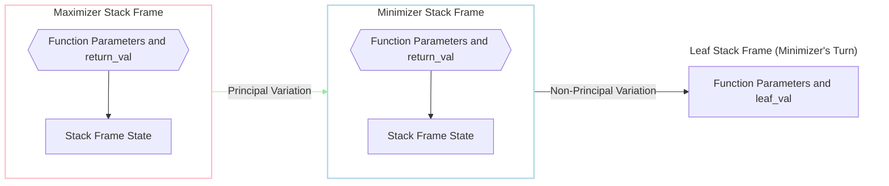
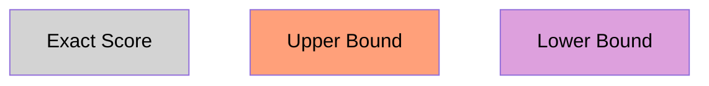

## Example

```mermaid
graph TD
    subgraph RootStackFrame [ "" ]
    RootValue
    RootValue --> PreAState
    RootValue --> PreBState
    RootValue --> PreCState
    end
    PreAState["curr_max = -&infin;\n\n&alpha; = -&infin;\n&beta; = &infin;"]:::NormalState --> AStackFrame
        subgraph AStackFrame[ "" ]
        AValue
        AValue --> PreAAState
        AValue --> PreABState
        end
        PreAAState["curr_min = &infin;\n\n&alpha; = -&infin;\n&beta; = &infin;"]:::NormalState --> AAStackFrame
            subgraph AAStackFrame [ "" ]
            AAValue
            AAValue --> PreAAAState
            AAValue --> PreAABState
            end
            PreAAAState["curr_max = -&infin;\n\n&alpha; = -&infin;\n&beta; = &infin;"]:::NormalState --> AAA
                AAA["Function Parameters:\n&alpha; = -&infin;\n&beta; = &infin;\n\n<font size = 5>leaf_val = 1</font>"]:::ExactScoreNode
            PreAABState["curr_max = 1\n\n&alpha; = 1\n&beta; = &infin;"]:::NormalState --> AAB
                AAB["Function Parameters:\n&alpha; = 1\n&beta; = &infin;\n\n<font size = 5>leaf_val = -1</font>"]:::UpperBoundNode
            AAValue{{"Function Parameters:\n&alpha; = -&infin;\n&beta; = &infin;\n\n<font size = 5>return_val = 1</font>"}}:::ExactScoreNode
        PreABState["curr_min = 1\n\n&alpha; = -&infin;\n&beta; = 1"]:::NormalState --> ABStackFrame
            subgraph ABStackFrame [ "" ]
            ABValue
            ABValue --> PreABAState
            ABValue --> PreABBState
            end
            PreABAState["curr_max = -&infin;\n\n&alpha; = -&infin;\n&beta; = 1"]:::NormalState --> ABA
                ABA["Function Parameters:\n&alpha; = -&infin;\n&beta; = 1\n\n<font size = 5>leaf_val = 4</font>"]:::LowerBoundNode
            PreABBState["curr_max = 4\n\n&alpha; = 4\n&beta; = 1"]:::PruningCauseState --> ABB
                ABB["Function Parameters:\n&alpha; = ?\n&beta; = ?\n\n<font size = 5>leaf_val = 5</font>"]:::PrunedNode
            ABValue{{"Function Parameters:\n&alpha; = -&infin;\n&beta; = 1\n\n<font size = 5>return_val = 4</font>"}}:::LowerBoundNode
        AValue{{"Function Parameters:\n&alpha; = -&infin;\n&beta; = &infin;\n\n<font size = 5>return_val = 1</font>"}}:::ExactScoreNode
    PreBState["curr_max = 1\n\n&alpha; = 1\n&beta; = &infin;"]:::NormalState --> BStackFrame
        subgraph BStackFrame [ "" ]
        BValue
        BValue --> PreBAState
        BValue --> PreBBState
        end
        PreBAState["curr_min = &infin;\n\n&alpha; = 1\n&beta; = &infin;"]:::NormalState --> BAStackFrame
            subgraph BAStackFrame [ "" ]
            BAValue
            BAValue --> PreBAAState
            BAValue --> PreBABState
            end
            PreBAAState["curr_max = -&infin;\n\n&alpha; = 1\n&beta; = &infin;"]:::NormalState --> BAA
                BAA["Function Parameters:\n&alpha; = 1\n&beta; = &infin;\n\n<font size = 5>leaf_val = -4</font>"]:::UpperBoundNode
            PreBABState["curr_max = -4\n\n&alpha; = 1\n&beta; = &infin;"]:::NormalState --> BAB
                BAB["Function Parameters:\n&alpha; = 1\n&beta; = &infin;\n\n<font size = 5>leaf_val = -3</font>"]:::UpperBoundNode
            BAValue{{"Function Parameters:\n&alpha; = 1\n&beta; = &infin;\n\n<font size = 5>return_val = -3</font>"}}:::UpperBoundNode
        PreBBState["curr_min = -3\n\n&alpha; = 1\n&beta; = -3"]:::PruningCauseState --> BBStackFrame
            subgraph BBStackFrame [ "" ]
            BBValue
            BBValue --> PreBBAState
            BBValue --> PreBBBState
            end
            PreBBAState["curr_max = ?\n\n&alpha; = ?\n&beta; = ?"]:::PrunedState --> BBA
                BBA["Function Parameters:\n&alpha; = ?\n&beta; = ?\n\n<font size = 5>leaf_val = -5</font>"]:::PrunedNode
            PreBBBState["curr_max = ?\n\n&alpha; = ?\n&beta; = ?"]:::PrunedState --> BBB
                BBB["Function Parameters:\n&alpha; = ?\n&beta; = ?\n\n<font size = 5>leaf_val = -4</font>"]:::PrunedNode
            BBValue{{"Function Parameters:\n&alpha; = ?\n&beta; = ?\n\n<font size = 5>return_val = ?</font>"}}:::PrunedNode
        BValue{{"Function Parameters:\n&alpha; = 1\n&beta; = &infin;\n\n<font size = 5>return_val = -3</font>"}}:::UpperBoundNode
    PreCState["curr_max = 1\n\n&alpha; = 1\n&beta; = &infin;"]:::NormalState --> CStackFrame
        subgraph CStackFrame [ "" ]
        CValue
        CValue --> PreCAState
        CValue --> PreCBState
        end
        PreCAState["curr_min = &infin;\n\n&alpha; = 1\n&beta; = &infin;"]:::NormalState --> CAStackFrame
            subgraph CAStackFrame [ "" ]
            CAValue
            CAValue --> PreCAAState
            CAValue --> PreCABState
            end
            PreCAAState["curr_max = -&infin;\n\n&alpha; = 1\n&beta; = &infin;"]:::NormalState --> CAA
                CAA["Function Parameters:\n&alpha; = 1\n&beta; = &infin;\n\n<font size = 5>leaf_val = 3</font>"]:::ExactScoreNode
            PreCABState["curr_max = 3\n\n&alpha; = 3\n&beta; = &infin;"]:::NormalState --> CAB
                CAB["Function Parameters:\n&alpha; = 3\n&beta; = &infin;\n\n<font size = 5>leaf_val = 0</font>"]:::UpperBoundNode
            CAValue{{"Function Parameters:\n&alpha; = 1\n&beta; = &infin;\n\n<font size = 5>return_val = 3</font>"}}:::ExactScoreNode
        PreCBState["curr_min = 3\n\n&alpha; = 1\n&beta; = 3"]:::NormalState --> CBStackFrame
            subgraph CBStackFrame [ "" ]
            CBValue
            CBValue --> PreCBAState
            CBValue --> PreCBBState
            end
            PreCBAState["curr_max = -&infin;\n\n&alpha; = 1\n&beta; = 3"]:::NormalState --> CBA
                CBA["Function Parameters:\n&alpha; = 1\n&beta; = 3\n\n<font size = 5>leaf_val = 4</font>"]:::LowerBoundNode
            PreCBBState["curr_max = 4\n\n&alpha; = 4\n&beta; = 3"]:::PruningCauseState --> CBB
                CBB["Function Parameters:\n&alpha; = ?\n&beta; = ?\n\n<font size = 5>leaf_val = -3</font>"]:::PrunedNode
            CBValue{{"Function Parameters:\n&alpha; = 1\n&beta; = 3\n\n<font size = 5>return_val = 4</font>"}}:::LowerBoundNode
        CValue{{"Function Parameters:\n&alpha; = 1\n&beta; = &infin;\n\n<font size = 5>return_val = 3</font>"}}:::ExactScoreNode
    RootValue{{"Function Parameters:\n&alpha; = -&infin;\n&beta; = &infin;\n\n<font size = 5>return_val = 3</font>"}}:::ExactScoreNode
    
    %% Stack Frames
    class RootStackFrame,AAStackFrame,ABStackFrame,BAStackFrame,BBStackFrame,CAStackFrame,CBStackFrame MaximizerStackFrame
    class AStackFrame,BStackFrame,CStackFrame MinimizerStackFrame
    classDef MaximizerStackFrame fill:transparent,stroke:pink,stroke-width:2px
    classDef MinimizerStackFrame fill:transparent,stroke:lightBlue,stroke-width:2px

    %% Return Value Nodes
    classDef ExactScoreNode fill:lightGray,color:black;
    classDef UpperBoundNode fill:lightSalmon,color:black;
    classDef LowerBoundNode fill:plum,color:black;
    classDef PrunedNode fill:darkRed,color:white;

    %% State Nodes
    classDef PruningCauseState fill:red,color:white;
    classDef PrunedState fill:darkRed,color:white;
    classDef NormalState fill:canvas,color:canvasText

    %% Best Path
    linkStyle 2,29,30,32,33,35 stroke:lightGreen;
```

## Legend
### Stack Frame Legend

### Return Value Legend

### Stack State Legend

## Notes
### Step-By-Step Walkthrough
The example above is a slightly modified version of this [Step-By-Step Video](https://www.youtube.com/watch?v=xBXHtz4Gbdo).
The numbers are reduced slightly, and a couple of values are swapped to show off the idea that leaf nodes can be negative or zero.
However, it still walks and prunes in the same way.

### Defining the "Exact Score" of a Node, the Alpha Parameter, and the Beta Parameter
First, we must define the `exact_score` of a node to be the score that the [base minimax algorithm](./unsorted_normal_minimax.md) would return.
Alpha-Beta does not always return the `exact_score`. Its `return_value` depends on the `alpha` and `beta` values provided to it.

The function parameters `alpha` and `beta` can be defined as the non-inclusive window `(alpha, beta)` for which this function must return the `exact_score`.
If the `exact_score` is outside of `(alpha, beta)`, the function must just return some value indicating if `exact_score <= alpha` or `beta <= exact_score`.
The exact ways alpha-beta implementations can "indicate" this are discussed in more depth [below](#different-implementations-of-bounds).
The TLDR is that some "upper bound" return value indicates `exact_score <= alpha` and some "lower bound" return value indicates `beta <= exact_score`

### Who sets “Alpha” and “Beta”, and how does “Pruning” Work?
When the very first node is evaluated, the search window is set to `(-∞, ∞)`, forcing the `exact_score` of the node is returned.
While doing the recursion, `alpha` gets set to “the best value that any maximizer ancestor of this node (or this node, if a maximizer) can currently guarantee”.
Similarly, `beta` get set to “the best value that any minimizer ancestor of this node (or this node, if a minimizer) can currently guarantee”.

These are chosen because if `beta <= child_node_return_val` then `child_node_return_val` will necessarily have no affect on the final evaluation of the root node.
This is the case because if the `child_node_return_val` gets propagated back far enough that it reaches the minimizer who set `beta`, that minimizer will ignore it in favor of their current minimum.
Similarly, if `child_node_return_val <= alpha` then `child_node_return_val` will necessarily have no affect on the final evaluation of the root node.

As a result, any state where `beta <= alpha` triggers a "prune": no more child nodes are explored and the current max or min is returned.
Pruning occurs because if the next child node was explored, any integer `child_node_return_val` would either satisfy `beta <= child_node_return_val` or `child_node_return_val <= alpha`.
Additionally, the current node necessarily has enough evidence to confidently return either an lower bound (if a maximizer) or upper bound (if a minimizer).
So regardless of what value the next child returns, it will never affect the final evaluation of the root node or the return value of its parent.

**Pruning is the entire point of Alpha-Beta**.
It allows you to completely omit exploring huge sections of the tree, regardless of how far down that section of the tree would go.
Many follow-up algorithms are essentially efforts to get slightly more pruning out of this base algorithm.

### Different Implementations of Bounds
#### 1. Fail-Hard
In this implementation, if the `exact_score` is outside of the window `(alpha, beta)`, the function will either return:
* `alpha` itself to signal that `exact_score <= alpha`
  * `alpha` is a "loose" upper bound on the `exact_score`
* `beta` itself to signal that `beta <= exact_score`
  * `beta` is a "loose" lower bound on the `exact_score`

Consider the case where an isolated alpha-beta evaluation of a root node is started with a search window of `(-∞, ∞)`.
Eventually, some child node will be evaluated where `alpha` or `beta` is a finite value.
In this case, there is no reason for any child node's alpha-beta evaluation to ever return any tighter bounds than `alpha` or `beta` itself.
Take `beta` for example: it got its finite value because some minimizer ancestor currently has a min of `beta`.
If the `exact_score` of the child node is `beta + 2`, it does not matter if the child node returns `beta + 2`, `beta + 1`, or `beta`.
They will all be ignored by that maximizer node equally.
The same logic applies to `alpha`.

Therefore, `alpha` and `beta` can simply be returned.
By doing this, you are able to initialize each maximizer node's `curr_max` to `alpha` rather than `-∞`.
You can do this because even if all of your children return values less than `alpha`, your plan is to return `alpha` yourself anyways.
Each minimizer node's `curr_min` can similarly be initialized to `beta` rather than `∞`.
Doing this allows the implementation to have one less variable, as each stack frame's copy of `alpha` and `beta` can be mutated directly while computing the max or min.

#### 2. Fail-Soft
In this implementation, the function will still prune just as aggressively but will return the tightest bound that it can.
The basic rules for doing so are:
* Leaf nodes return their `exact_score`
  * This is where all "tight bounds" begin
* Parent nodes will:
  * Initialize their `curr_max` to `-∞` (maximizer) or `curr_min` to `∞` (minimizer)
  * If no pruning occurred, return their best child node's `return_val` (unmodified) 
    * This allows "tight bounds" to propagate some distance up the stack trace
  * If pruning occurred, return the `return_val` of the child node which caused the pruning (unmodified)
    * This also allows "tight bounds" to propagate some distance up the stack trace.
    * However, the fact that other children were pruned means that this node is not necessarily returning its `exact_score` or even the tightest bound. The next child could get even closer to the `exact_score`.

Tight bounds provide no benefits over loose bounds for an isolated alpha-beta evaluation of a root node, where the search window begins at `(-∞, ∞)`, and there is no transposition table.
However if there is any mechanism for a node's bound to be "re-used" outside of its immediate ancestry (i.e. transposition tables and / or iterative deepening) then they provide benefits.
They are beneficial because if the same node is re-explored with a different `(alpha, beta)` range, the tighter bound might be sufficient to trigger a prune where the looser bound is insufficient. 

For this reason, tight bounds are used exclusively for all other discussions and subsequent algorithms.

### Return Values Explained
Callers of alpha-beta can interpret the `return_value` according to:
* If `alpha < return_value < beta`, then `return_value == exact_score`
  * The `exact_score` was returned
* If `return_value <= alpha`, then `exact_score <= return_value`
  * An upper bound was returned
* If `beta <= return_value`, then `return_value <= exact_score`
  * A lower bound was returned

The implementation of the function must guarantee that:
* If `alpha < exact_score < beta`, then `return_value == exact_score`
  * Must return the `exact_score`
* If `exact_score <= alpha`, then `exact_score <= return_value <= alpha`
  * Only required to return an upper bound (may be equal to the `exact_score` or equal to `alpha`)
* If `beta <= exact_score`, then `beta <= return_value <= exact_score`
  * Only required to return an lower bound (may be equal to the `exact_score` or equal to `beta`)

