## Example

```mermaid
graph TD
    subgraph RootStackFrame [ "" ]
    RootValue
    RootValue --> PreAState
    RootValue --> PreBState
    RootValue --> PreCState
    end
    PreAState["curr_max = -&infin;\n\n&alpha; = -&infin;\n&beta; = &infin;"]:::NormalState --> AStackFrame
        subgraph AStackFrame[ "" ]
        AValue
        AValue --> PreAAState
        AValue --> PreABState
        end
        PreAAState["curr_max = -&infin;\n\n&alpha; = -&infin;\n&beta; = &infin;"]:::NormalState --> AAStackFrame
            subgraph AAStackFrame [ "" ]
            AAValue
            AAValue --> PreAAAState
            AAValue --> PreAABState
            end
            PreAAAState["curr_max = -&infin;\n\n&alpha; = -&infin;\n&beta; = &infin;"]:::NormalState --> AAA
                AAA["Function Parameters:\n&alpha; = -&infin;\n&beta; = &infin;\n\n<font size = 5>leaf_val = -1</font>"]:::ExactScoreNode
            PreAABState["curr_max = 1\n\n&alpha; = 1\n&beta; = &infin;"]:::NormalState --> AAB
                AAB["Function Parameters:\n&alpha; = -&infin;\n&beta; = -1\n\n<font size = 5>leaf_val = 1</font>"]:::LowerBoundNode
            AAValue{{"Function Parameters:\n&alpha; = -&infin;\n&beta; = &infin;\n\n<font size = 5>return_val = 1</font>"}}:::ExactScoreNode
        PreABState["curr_max = -1\n\n&alpha; = -1\n&beta; = &infin;"]:::NormalState --> ABStackFrame
            subgraph ABStackFrame [ "" ]
            ABValue
            ABValue --> PreABAState
            ABValue --> PreABBState
            end
            PreABAState["curr_max = -&infin;\n\n&alpha; = -&infin;\n&beta; = 1"]:::NormalState --> ABA
                ABA["Function Parameters:\n&alpha; = -1\n&beta; = &infin;\n\n<font size = 5>leaf_val = -4</font>"]:::UpperBoundNode
            PreABBState["curr_max = 4\n\n&alpha; = 4\n&beta; = 1"]:::PruningCauseState --> ABB
                ABB["Function Parameters:\n&alpha; = ?\n&beta; = ?\n\n<font size = 5>leaf_val = -5</font>"]:::PrunedNode
            ABValue{{"Function Parameters:\n&alpha; = -&infin;\n&beta; = 1\n\n<font size = 5>return_val = 4</font>"}}:::LowerBoundNode
        AValue{{"Function Parameters:\n&alpha; = -&infin;\n&beta; = &infin;\n\n<font size = 5>return_val = -1</font>"}}:::ExactScoreNode
    PreBState["curr_max = 1\n\n&alpha; = 1\n&beta; = &infin;"]:::NormalState --> BStackFrame
        subgraph BStackFrame [ "" ]
        BValue
        BValue --> PreBAState
        BValue --> PreBBState
        end
        PreBAState["curr_max = -&infin;\n\n&alpha; = -&infin;\n&beta; = -1"]:::NormalState --> BAStackFrame
            subgraph BAStackFrame [ "" ]
            BAValue
            BAValue --> PreBAAState
            BAValue --> PreBABState
            end
            PreBAAState["curr_max = -&infin;\n\n&alpha; = 1\n&beta; = &infin;"]:::NormalState --> BAA
                BAA["Function Parameters:\n&alpha; = -&infin;\n&beta; = -1\n\n<font size = 5>leaf_val = 4</font>"]:::LowerBoundNode
            PreBABState["curr_max = -4\n\n&alpha; = 1\n&beta; = &infin;"]:::NormalState --> BAB
                BAB["Function Parameters:\n&alpha; = -&infin;\n&beta; = -1\n\n<font size = 5>leaf_val = 3</font>"]:::LowerBoundNode
            BAValue{{"Function Parameters:\n&alpha; = 1\n&beta; = &infin;\n\n<font size = 5>return_val = -3</font>"}}:::UpperBoundNode
        PreBBState["curr_max = 3\n\n&alpha; = 3\n&beta; = -1"]:::PruningCauseState --> BBStackFrame
            subgraph BBStackFrame [ "" ]
            BBValue
            BBValue --> PreBBAState
            BBValue --> PreBBBState
            end
            PreBBAState["curr_max = ?\n\n&alpha; = ?\n&beta; = ?"]:::PrunedState --> BBA
                BBA["Function Parameters:\n&alpha; = ?\n&beta; = ?\n\n<font size = 5>leaf_val = 5</font>"]:::PrunedNode
            PreBBBState["curr_max = ?\n\n&alpha; = ?\n&beta; = ?"]:::PrunedState --> BBB
                BBB["Function Parameters:\n&alpha; = ?\n&beta; = ?\n\n<font size = 5>leaf_val = 4</font>"]:::PrunedNode
            BBValue{{"Function Parameters:\n&alpha; = ?\n&beta; = ?\n\n<font size = 5>return_val = ?</font>"}}:::PrunedNode
        BValue{{"Function Parameters:\n&alpha; = -&infin;\n&beta; = -1\n\n<font size = 5>return_val = 3</font>"}}:::LowerBoundNode
    PreCState["curr_max = 1\n\n&alpha; = 1\n&beta; = &infin;"]:::NormalState --> CStackFrame
        subgraph CStackFrame [ "" ]
        CValue
        CValue --> PreCAState
        CValue --> PreCBState
        end
        PreCAState["curr_max = -&infin;\n\n&alpha; = -&infin;\n&beta; = -1"]:::NormalState --> CAStackFrame
            subgraph CAStackFrame [ "" ]
            CAValue
            CAValue --> PreCAAState
            CAValue --> PreCABState
            end
            PreCAAState["curr_max = -&infin;\n\n&alpha; = 1\n&beta; = &infin;"]:::NormalState --> CAA
                CAA["Function Parameters:\n&alpha; = -&infin;\n&beta; = -1\n\n<font size = 5>leaf_val = -3</font>"]:::ExactScoreNode
            PreCABState["curr_max = 3\n\n&alpha; = 3\n&beta; = &infin;"]:::NormalState --> CAB
                CAB["Function Parameters:\n&alpha; = -&infin;\n&beta; = -3\n\n<font size = 5>leaf_val = 0</font>"]:::LowerBoundNode
            CAValue{{"Function Parameters:\n&alpha; = 1\n&beta; = &infin;\n\n<font size = 5>return_val = 3</font>"}}:::ExactScoreNode
        PreCBState["curr_max = -3\n\n&alpha; = -3\n&beta; = -1"]:::NormalState --> CBStackFrame
            subgraph CBStackFrame [ "" ]
            CBValue
            CBValue --> PreCBAState
            CBValue --> PreCBBState
            end
            PreCBAState["curr_max = -&infin;\n\n&alpha; = 1\n&beta; = 3"]:::NormalState --> CBA
                CBA["Function Parameters:\n&alpha; = -3\n&beta; = -1\n\n<font size = 5>leaf_val = -4</font>"]:::UpperBoundNode
            PreCBBState["curr_max = 4\n\n&alpha; = 4\n&beta; = 3"]:::PruningCauseState --> CBB
                CBB["Function Parameters:\n&alpha; = ?\n&beta; = ?\n\n<font size = 5>leaf_val = 3</font>"]:::PrunedNode
            CBValue{{"Function Parameters:\n&alpha; = 1\n&beta; = 3\n\n<font size = 5>return_val = 4</font>"}}:::LowerBoundNode
        CValue{{"Function Parameters:\n&alpha; = -&infin;\n&beta; = -1\n\n<font size = 5>return_val = -3</font>"}}:::ExactScoreNode
    RootValue{{"Function Parameters:\n&alpha; = -&infin;\n&beta; = &infin;\n\n<font size = 5>return_val = 3</font>"}}:::ExactScoreNode
    
    %% Stack Frames
    class RootStackFrame,AAStackFrame,ABStackFrame,BAStackFrame,BBStackFrame,CAStackFrame,CBStackFrame StackFrame
    class AStackFrame,BStackFrame,CStackFrame StackFrame
    classDef StackFrame fill:transparent,stroke:gray,stroke-width:2px

    %% Return Value Nodes
    classDef ExactScoreNode fill:lightGray,color:black;
    classDef UpperBoundNode fill:lightSalmon,color:black;
    classDef LowerBoundNode fill:plum,color:black;
    classDef PrunedNode fill:darkRed,color:white;

    %% State Nodes
    classDef PruningCauseState fill:red,color:white;
    classDef PrunedState fill:darkRed,color:white;
    classDef NormalState fill:canvas,color:canvasText

    %% Best Path
    linkStyle 2,29,30,32,33,35 stroke:lightGreen;
```

## Legend
Same as the [Alpha-Beta Minimax Legend](./unsorted_alpha_beta_minimax.md#legend), except the stack frames do not differentiate between "Maximizer" and "Minimizer";
in any Negamax algorithm, each node believes that it is a "Maximizer".

## Notes
### How it Works
In many ways, it just combines the ideas from the [base negamax algorithm](./unsorted_normal_negamax.md) and the [alpha-beta minimax algorithm](./unsorted_alpha_beta_minimax.md).
The main subtly is the fact that when the recursion happens, it modifies the tuple `(alpha, beta)` into `(-beta, -alpha)`.
This is an extension of the idea from the `base negamax algorithm`:
> At each step of the evaluation process, the algorithm believes that it is the maximizer / player-1. It then “lies” to its children, letting them think that they are the maximizer / player-1

### How it Simplifies the Pruning Concept
Because every node is a maximizer, only `alpha` has the potential to be updated based on the value of a child node; `beta` is never mutated in the stack frame, and instead gets its mutation from the `(-beta, -alpha)` transformation.
So, pruning happens if and only if a child is found whose value is greater than `beta`.
Finding a child node whose value is less than `alpha` never immediately causes a prune (it *may* cause a prune higher up in the stack trace if no better children are found).

### What it Clarifies about Bounded Returns
The example showcases the fact that a node returning an upper-bound value always causes the parent to immediately return (i.e. prune if there are more children) with a lower-bound value.
Conversely, returning a lower-bound value can never trigger a prune, since the parent will negate and see a value which is less than its current `alpha` (and so less than its current `beta` as well).

The example also shows that if a node returns an upper-bound, then it necessarily explored all of its children and never was able to prune.
If a node returns a lower-bound, it was *likely* pruned (unless it is a leaf node, or the move sorting was so bad that the best child node was the very last one explored).
This implies that for two nodes with the same depth, one returning an upper-bound likely took longer to evaluate than one returning a lower-bound node.
This can have an affect on game engine design; transposition tables can use this fact in their eviction policy to cache the more "expensive" node.

These patterns would be hard to observe in `alpha-beta minimax`, as you would need to define unwieldly terms like "upper-bound if maximizer, but lower-bound if minimizer".

