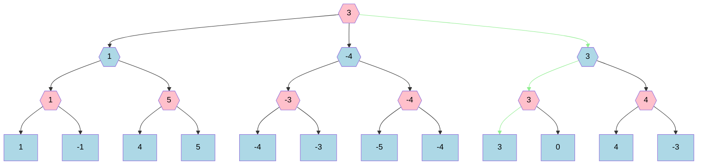
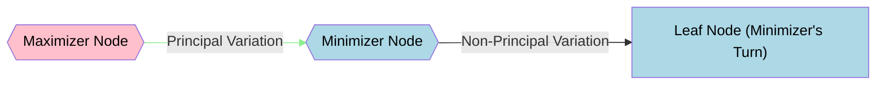

## Example


## Legend


## Notes
The base algorithm for any two-player, turn-based game with no hidden information and no randomness.
It is somewhat intuitive that this algorithm can even serve as a *definition* of what is meant by statements like "with perfect play, this game will end with ...".
All subsequent algorithms have the goal of returning the same principal variation and starting node evaluation, but will differ in their implementations to pursue performance improvements.

It can be expressed with the pseudocode
```
fn minimax<T:Ord>(node: NodeType, is_maximizer: bool) -> T {
    if node.is_leaf() {
        return node.get_leaf_score();
    }

    let child_eval_iter = node.generate_child_moves(is_maximizer)
        .map(|child_node| minimax(child_node, !is_maximizer));

    if is_maximizer {
        child_eval_iter.max()
    } else {
        child_eval_iter.min()
    }
}
```

To return the principal variation, each call can also somehow return or store a reference to its best child.
These can then be stitched together into a path from the root to leaf.
