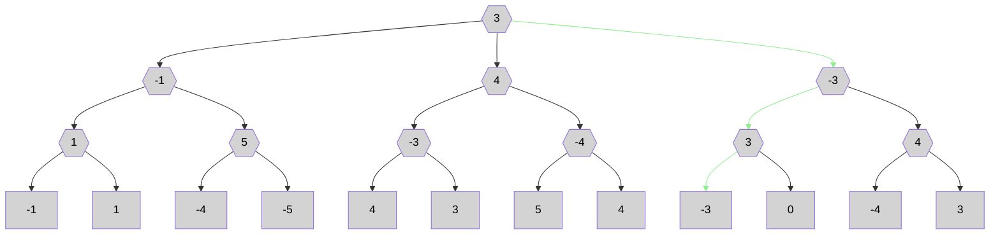
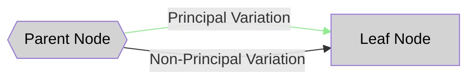

## Example


## Legend


## Notes
A slight simplification and performance improvement over the [base minimax algorithm](./unsorted_normal_minimax.md).

It can be expressed with the pseudocode
```
fn negamax(node: NodeType) -> ReturnEvalType {
    if node.is_leaf() {
        node.get_leaf_score()
    } else {
        node.children_iter()
            .map(|child_node| -negamax(child_node.flip_game_state()))
            .max()
    }
}
```

At each step of the evaluation process, the algorithm believes that it is the maximizer / player-1.
It then "lies" to its children, letting them think that they are the maximizer / player-1.
It does this by "flipping the game state"; in tic-tak-toe this would involve replacing all the "X's with O's" and vice-versa.

Each recursive call will then naturally generate a response saying how good the child position is for the other player.
These are immediately negated, so that all values say how good the position is for the current player, and then the max is returned.

It is simpler in the sense that a recursive DFS implementation of the `base minimax algorithm` would have a boolean (`is_maximizer`) which must be:
* Checked before generating the possible child positions (which moves are legal)
* Checked before aggregating the child evaluations (maximize or minimize)
* Negated before being passed in the recursive function call

These `if-else` statements and negations are removed completely with this algorithm.
The only added complexity comes from needing to flip the entire game state. However, this is generally easy and fast in practice.
So this algorithm generally leads to less code and better performance.

