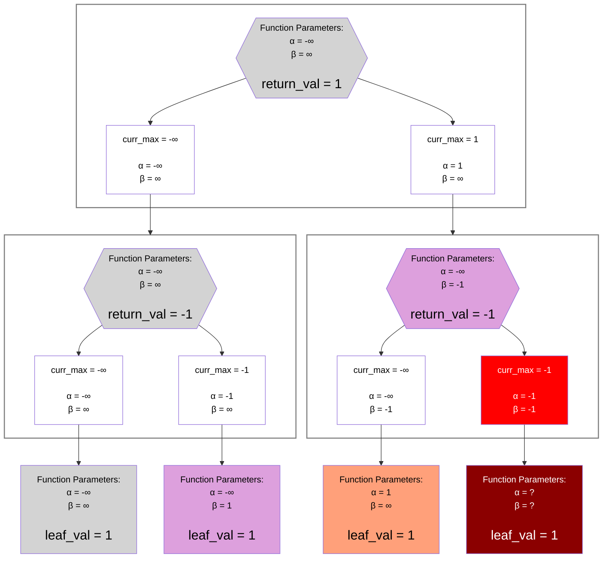

## Worst-Case Example

```mermaid
graph TD
    subgraph RootStackFrame [ "" ]
    RootValue
    RootValue --> PreAState
    RootValue --> PreBState
    RootValue --> PreCState
    end
    PreAState["curr_max = -&infin;\n\n&alpha; = -&infin;\n&beta; = &infin;"]:::NormalState --> AStackFrame
        subgraph AStackFrame[ "" ]
        AValue
        AValue --> PreAAState
        AValue --> PreABState
        end
        PreAAState["curr_max = -&infin;\n\n&alpha; = -&infin;\n&beta; = &infin;"]:::NormalState --> AAStackFrame
            subgraph AAStackFrame [ "" ]
            AAValue
            AAValue --> PreAAAState
            AAValue --> PreAABState
            end
            PreAAAState["curr_max = -&infin;\n\n&alpha; = -&infin;\n&beta; = &infin;"]:::NormalState --> AAA
                AAA["Function Parameters:\n&alpha; = -&infin;\n&beta; = &infin;\n\n<font size = 5>leaf_val = 4</font>"]:::ExactScoreNode
            PreAABState["curr_max = -4\n\n&alpha; = -4\n&beta; = &infin;"]:::NormalState --> AAB
                AAB["Function Parameters:\n&alpha; = -&infin;\n&beta; = 4\n\n<font size = 5>leaf_val = 3</font>"]:::ExactScoreNode
            AAValue{{"Function Parameters:\n&alpha; = -&infin;\n&beta; = &infin;\n\n<font size = 5>return_val = -3</font>"}}:::ExactScoreNode
        PreABState["curr_max = 3\n\n&alpha; = 3\n&beta; = &infin;"]:::NormalState --> ABStackFrame
            subgraph ABStackFrame [ "" ]
            ABValue
            ABValue --> PreABAState
            ABValue --> PreABBState
            end
            PreABAState["curr_max = -&infin;\n\n&alpha; = -&infin;\n&beta; = -3"]:::NormalState --> ABA
                ABA["Function Parameters:\n&alpha; = 3\n&beta; = &infin;\n\n<font size = 5>leaf_val = 5</font>"]:::ExactScoreNode
            PreABBState["curr_max = -5\n\n&alpha; = -5\n&beta; = -3"]:::NormalState --> ABB
                ABB["Function Parameters:\n&alpha; = 3\n&beta; = 5\n\n<font size = 5>leaf_val = 4</font>"]:::ExactScoreNode
            ABValue{{"Function Parameters:\n&alpha; = -&infin;\n&beta; = -3\n\n<font size = 5>return_val = -4</font>"}}:::ExactScoreNode
        AValue{{"Function Parameters:\n&alpha; = -&infin;\n&beta; = &infin;\n\n<font size = 5>return_val = 4</font>"}}:::ExactScoreNode
    PreBState["curr_max = -4\n\n&alpha; = -4\n&beta; = &infin;"]:::NormalState --> BStackFrame
        subgraph BStackFrame [ "" ]
        BValue
        BValue --> PreBAState
        BValue --> PreBBState
        end
        PreBAState["curr_max = -&infin;\n\n&alpha; = -&infin;\n&beta; = 4"]:::NormalState --> BAStackFrame
            subgraph BAStackFrame [ "" ]
            BAValue
            BAValue --> PreBAAState
            BAValue --> PreBABState
            end
            PreBAAState["curr_max = -&infin;\n\n&alpha; = -4\n&beta; = &infin;"]:::NormalState --> BAA
                BAA["Function Parameters:\n&alpha; = -&infin;\n&beta; = 4\n\n<font size = 5>leaf_val = -4</font>"]:::ExactScoreNode
            PreBABState["curr_max = 4\n\n&alpha; = 4\n&beta; = &infin;"]:::NormalState --> BAB
                BAB["Function Parameters:\n&alpha; = -&infin;\n&beta; = -4\n\n<font size = 5>leaf_val = -5</font>"]:::ExactScoreNode
            BAValue{{"Function Parameters:\n&alpha; = -4\n&beta; = &infin;\n\n<font size = 5>return_val = 5</font>"}}:::ExactScoreNode
        PreBBState["curr_max = -5\n\n&alpha; = -5\n&beta; = 4"]:::NormalState --> BBStackFrame
            subgraph BBStackFrame [ "" ]
            BBValue
            BBValue --> PreBBAState
            BBValue --> PreBBBState
            end
            PreBBAState["curr_max = -&infin;\n\n&alpha; = -4\n&beta; = 5"]:::NormalState --> BBA
                BBA["Function Parameters:\n&alpha; = -5\n&beta; = 4\n\n<font size = 5>leaf_val = 1</font>"]:::ExactScoreNode
            PreBBBState["curr_max = -1\n\n&alpha; = -1\n&beta; = 5"]:::NormalState --> BBB
                BBB["Function Parameters:\n&alpha; = -5\n&beta; = 1\n\n<font size = 5>leaf_val = -1</font>"]:::ExactScoreNode
            BBValue{{"Function Parameters:\n&alpha; = -4\n&beta; = 5\n\n<font size = 5>return_val = 1</font>"}}:::ExactScoreNode
        BValue{{"Function Parameters:\n&alpha; = -&infin;\n&beta; = 4\n\n<font size = 5>return_val = -1</font>"}}:::ExactScoreNode
    PreCState["curr_max = 1\n\n&alpha; = 1\n&beta; = &infin;"]:::NormalState --> CStackFrame
        subgraph CStackFrame [ "" ]
        CValue
        CValue --> PreCAState
        CValue --> PreCBState
        end
        PreCAState["curr_max = -&infin;\n\n&alpha; = -&infin;\n&beta; = -1"]:::NormalState --> CAStackFrame
            subgraph CAStackFrame [ "" ]
            CAValue
            CAValue --> PreCAAState
            CAValue --> PreCABState
            end
            PreCAAState["curr_max = -&infin;\n\n&alpha; = 1\n&beta; = &infin;"]:::NormalState --> CAA
                CAA["Function Parameters:\n&alpha; = -&infin;\n&beta; = -1\n\n<font size = 5>leaf_val = 3</font>"]:::LowerBoundNode
            PreCABState["curr_max = -3\n\n&alpha; = 1\n&beta; = &infin;"]:::NormalState --> CAB
                CAB["Function Parameters:\n&alpha; = -&infin;\n&beta; = -1\n\n<font size = 5>leaf_val = -4</font>"]:::ExactScoreNode
            CAValue{{"Function Parameters:\n&alpha; = 1\n&beta; = &infin;\n\n<font size = 5>return_val = 4</font>"}}:::ExactScoreNode
        PreCBState["curr_max = -4\n\n&alpha; = -4\n&beta; = -1"]:::NormalState --> CBStackFrame
            subgraph CBStackFrame [ "" ]
            CBValue
            CBValue --> PreCBAState
            CBValue --> PreCBBState
            end
            PreCBAState["curr_max = -&infin;\n\n&alpha; = 1\n&beta; = 4"]:::NormalState --> CBA
                CBA["Function Parameters:\n&alpha; = -4\n&beta; = -1\n\n<font size = 5>leaf_val = 0</font>"]:::LowerBoundNode
            PreCBBState["curr_max = 0\n\n&alpha; = 1\n&beta; = 4"]:::NormalState --> CBB
                CBB["Function Parameters:\n&alpha; = -4\n&beta; = -1\n\n<font size = 5>leaf_val = -3</font>"]:::ExactScoreNode
            CBValue{{"Function Parameters:\n&alpha; = 1\n&beta; = 4\n\n<font size = 5>return_val = 3</font>"}}:::ExactScoreNode
        CValue{{"Function Parameters:\n&alpha; = -&infin;\n&beta; = -1\n\n<font size = 5>return_val = -3</font>"}}:::ExactScoreNode
    RootValue{{"Function Parameters:\n&alpha; = -&infin;\n&beta; = &infin;\n\n<font size = 5>return_val = 3</font>"}}:::ExactScoreNode
    
    %% Stack Frames
    class RootStackFrame,AAStackFrame,ABStackFrame,BAStackFrame,BBStackFrame,CAStackFrame,CBStackFrame StackFrame
    class AStackFrame,BStackFrame,CStackFrame StackFrame
    classDef StackFrame fill:transparent,stroke:gray,stroke-width:2px

    %% Return Value Nodes
    classDef ExactScoreNode fill:lightGray,color:black;
    classDef UpperBoundNode fill:lightSalmon,color:black;
    classDef LowerBoundNode fill:plum,color:black;
    classDef PrunedNode fill:darkRed,color:white;

    %% State Nodes
    classDef PruningCauseState fill:red,color:white;
    classDef PrunedState fill:darkRed,color:white;
    classDef NormalState fill:canvas,color:canvasText

    %% Best Path
    linkStyle 2,29,31,37,39,41 stroke:lightGreen;
```

## Legend
Same as the [Alpha-Beta Negamax Legend](./unsorted_alpha_beta_negamax.md#legend)

## Notes
### No Pruning
In this example, there is unfortunately no pruning at all.
So it is clearly less than the unsorted example.
In fact, it would explore the same number of nodes as the [base negamax algorithm](./unsorted_normal_negamax.md), but slightly slower since it is also computing `alpha` and `beta` values.

### Why This Is Not a Practical Concern
One might see this fact and worry that implementing alpha-beta is risky, as it could theoretically be slightly slower.
However, even a random move ordering would yield some pruning, which more than makes up for the `alpha` and `beta` bookkeeping.

Moreover, it is even possible to achieve some pruning with the worst possible move ordering.
As a trivial example, consider the case where all leaf nodes have the same value.
In this case, the "worst" possible move order is equal to the "best" possible move order and we see:

